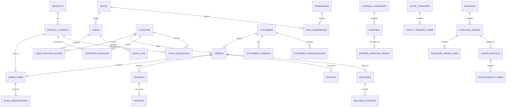

# Dscentsation Management System — Database Design

**Document status:** Draft for project-manager review  
**Task:** 002 — Technical Architecture  
**Database:** PostgreSQL  
**Purpose:** Logical schema proposal; this is not an executable migration or evidence that a database has been provisioned.

## 1. Design principles

1. PostgreSQL is the authoritative store for business records.
2. Enforce relationships and important invariants in the database as well as in application services.
3. Use UUID primary keys for internal entities. Add human-readable order/receipt references separately.
4. Store timestamps as `TIMESTAMPTZ` in UTC. Convert to/from `Africa/Lagos` for business-facing dates and reporting.
5. Store NGN money as integer minor units (kobo) in `BIGINT` columns, with a three-letter currency code (initially `NGN`). Never use floating-point values for money.
6. Store quantities as `NUMERIC(14,3)` or a narrower agreed precision, with a defined unit of measure per product variant.
7. Use foreign keys and deliberate deletion rules. Products, customers, orders, payments, movements and audit history must not be hard-deleted when historical records depend on them.
8. Keep immutable event/history records for stock and financial activity. Correct errors with reversal/adjustment records.
9. Use transactions for changes that affect multiple records or financial/stock invariants.
10. Keep personal/customer data and production business records out of GitHub, screenshots and test fixtures.

### Common columns

For mutable business entities, use:

- `id UUID PRIMARY KEY`
- `created_at TIMESTAMPTZ NOT NULL DEFAULT now()`
- `updated_at TIMESTAMPTZ NOT NULL DEFAULT now()`
- `created_by UUID REFERENCES users(id)` and/or `updated_by` where human attribution is relevant
- A deliberate `status` or `archived_at` field instead of hard deletion

Append-only event tables generally need `id`, `occurred_at`, `actor_user_id` and the relevant relationship/reference fields. Do not update or delete events as part of ordinary operations.

## 2. Entity groups

### 2.1 Users, roles and location access

| Table | Key columns | Purpose / relationships |
|---|---|---|
| `users` | `id`, `email` (unique, normalised), `display_name`, `password_hash`, `role_id`, `status`, `last_login_at`, `created_at`, `updated_at` | One individual login per person. Role references `roles.id`. Never store plaintext passwords. |
| `roles` | `id`, `code` (unique), `name`, `description` | Seed Owner, Manager and Staff. |
| `permissions` | `id`, `code` (unique), `description` | Explicit permissions such as `orders.create`, `payments.verify`, `inventory.transfer.dispatch`, `reports.finance.view`. |
| `role_permissions` | `role_id`, `permission_id` (composite unique/PK) | Many-to-many role-to-permission mapping. |
| `user_location_access` | `user_id`, `location_id`, `granted_by`, `created_at` | Optional location restrictions for Staff/Managers. Owner access is global by policy. |

**Relationships:** One role has many users; roles and permissions are many-to-many; users and locations are many-to-many through `user_location_access`.

Use deny-by-default checks in backend services. The frontend may use the current role to present the right navigation, but API permission checks remain mandatory. The final permission mapping and exceptions require business approval.

### 2.2 Locations

| Table | Key columns | Purpose / relationships |
|---|---|---|
| `locations` | `id`, `code` (unique), `name`, `address`, `contact_name`, `contact_phone`, `is_active` | Physical stock/fulfilment locations. Names and number of locations are still to be supplied by the business. |

Orders, stock balances, movements, transfers and user location grants reference `locations`.

### 2.3 Customers and communications preferences

| Table | Key columns | Purpose / relationships |
|---|---|---|
| `customers` | `id`, `full_name`, `phone`, `email`, `notes`, `status`, timestamps | Internal CRM customer record. Store only contact details needed for operations. |
| `customer_consents` | `id`, `customer_id`, `purpose`, `channel`, `consent_status`, `captured_at`, `withdrawn_at`, `source`, `captured_by` | Separate and timestamp marketing consent from transactional messages. Preserve consent history. |
| `customer_communications` | `id`, `customer_id`, `order_id` nullable, `channel`, `message_type`, `direction`, `status`, `occurred_at`, `provider_reference` nullable | Record relevant communication history and provider outcomes without importing entire WhatsApp/Instagram conversations. |

**Relationship:** One customer has many orders, consents and communication records.

Birthday, preferences, segmentation and promotional follow-ups are optional/future functionality. Collect and use those fields only after the business approves the purpose, retention and consent process.

### 2.4 Manually maintained products

| Table | Key columns | Purpose / relationships |
|---|---|---|
| `product_categories` | `id`, `name`, `description`, `parent_id` nullable, `is_active` | Optional category hierarchy. |
| `products` | `id`, `category_id`, `name`, `description`, `status`, `image_file_id` nullable, timestamps | Internal DMS product record, manually created by authorised users. |
| `product_variants` | `id`, `product_id`, `name` (e.g. size/variant label), `sku` nullable, `unit_of_measure`, `selling_price_minor`, `cost_price_minor`, `currency`, `is_active` | Sellable/stocked unit. A product without real variants should still have one default variant so inventory has a consistent key. |

**Relationships:** A category can contain many products; a product has one or more variants; stock and order lines reference a variant.

**Manual-entry boundary:** These tables are created and maintained inside DMS. No website catalogue import, scraping, catalogue sync or dependency on an ecommerce product feed is part of this design. Product records may be archived, not removed, after they have transaction history.

### 2.5 Inventory balances and stock ledger

| Table | Key columns | Purpose / relationships |
|---|---|---|
| `inventory_balances` | `id`, `location_id`, `product_variant_id`, `quantity_on_hand`, `quantity_reserved`, `reorder_level`, `updated_at` | Current balance summary for one variant at one location. Unique constraint on (`location_id`, `product_variant_id`). |
| `stock_movements` | `id`, `location_id`, `product_variant_id`, `movement_type`, `quantity_delta`, `quantity_before`, `quantity_after`, `reason`, `reference_type`, `reference_id`, `idempotency_key`, `actor_user_id`, `occurred_at` | Append-only stock ledger. Positive/negative deltas show quantity changes at a specific location. |
| `stock_reservations` | `id`, `order_item_id`, `location_id`, `product_variant_id`, `quantity`, `status`, `reserved_at`, `released_at`, `consumed_at` | Connects confirmed order demand to stock reserved at a location. |
| `stock_transfers` | `id`, `reference` (unique), `source_location_id`, `destination_location_id`, `status`, `requested_by`, `dispatched_by`, `received_by`, timestamps | Transfer header and lifecycle. Source and destination must differ. |
| `stock_transfer_items` | `id`, `transfer_id`, `product_variant_id`, `quantity_requested`, `quantity_dispatched`, `quantity_received`, `discrepancy_reason` | Item-level quantities and receipt discrepancies. |
| `stock_counts` | `id`, `location_id`, `status`, `counted_by`, `reviewed_by`, `started_at`, `completed_at` | Physical stock-count session. |
| `stock_count_items` | `id`, `stock_count_id`, `product_variant_id`, `system_quantity`, `counted_quantity`, `variance`, `reason` | Captures count variances before an authorised adjustment movement is posted. |

**Relationships:** Each balance belongs to one location and variant. A variant has many balances and movements. Transfers have many transfer items and produce corresponding stock movements. Reservations link an order line to the location/variant whose stock is committed.

#### Inventory invariants

- `available = quantity_on_hand - quantity_reserved`; calculate it from the balance row or a database view rather than accepting it from the browser.
- Enforce `quantity_on_hand >= 0`, `quantity_reserved >= 0` and `quantity_reserved <= quantity_on_hand` unless the business explicitly approves a different policy.
- Lock the relevant `inventory_balances` rows (for example with `SELECT ... FOR UPDATE`) inside a transaction before checking or changing a balance.
- A reservation may not exceed available quantity.
- Reservation, order state and reservation history changes must commit or roll back together.
- Dispatch decreases on-hand and the corresponding reservation together; cancellation releases the reservation once.
- A transfer dispatch reduces stock at the source. Destination stock increases only when the destination confirms receipt.
- Adjustments, damage, loss, return-to-stock and count reconciliation require movement records and reasons.
- Store an idempotency/business-operation key so retries cannot create duplicate movements.

The balance table is a transactionally maintained current-state projection. The append-only movement ledger is the evidence of how stock changed. Reconciliation tooling should be able to compare the two.

### 2.6 Orders, fulfilment and delivery

| Table | Key columns | Purpose / relationships |
|---|---|---|
| `orders` | `id`, `order_reference` (unique), `customer_id`, `source_channel`, `status`, `fulfilment_location_id`, `subtotal_minor`, `discount_minor`, `delivery_fee_minor`, `total_minor`, `currency`, `delivery_address_snapshot`, `notes`, `created_by`, timestamps | Order header. Source channel is WhatsApp, Instagram, website or phone. |
| `order_items` | `id`, `order_id`, `product_variant_id`, `product_name_snapshot`, `sku_snapshot`, `quantity`, `unit_price_minor`, `discount_minor`, `line_total_minor`, `cost_snapshot_minor` nullable | Item rows preserve the product name/SKU and financial values as they were when sold. |
| `order_status_history` | `id`, `order_id`, `from_status`, `to_status`, `reason`, `actor_user_id`, `occurred_at` | Immutable order lifecycle history. |
| `deliveries` | `id`, `order_id`, `courier_name`, `courier_phone`, `delivery_method`, `status`, `dispatched_at`, `delivered_at`, `failure_reason` | Delivery assignment and current delivery state. |
| `delivery_attempts` | `id`, `delivery_id`, `attempt_number`, `attempted_at`, `outcome`, `notes`, `proof_file_id` nullable, `recorded_by` | Individual delivery attempts, outcomes and optional proof metadata. |

**Relationships:** A customer has many orders; each order has many item rows and status-history rows; each order may have one or more payment/refund records, reservations and one delivery record; delivery has many attempts.

Order-line snapshots preserve historic receipts/reports if the source product is later renamed or archived. Order totals are recalculated and validated by the backend, never trusted from the browser.

### 2.7 Payments and refunds

| Table | Key columns | Purpose / relationships |
|---|---|---|
| `payments` | `id`, `order_id`, `amount_minor`, `currency`, `method`, `reference`, `status`, `recorded_by`, `verified_by` nullable, `verified_at` nullable, `occurred_at` | Append-oriented record of an amount reported as received for an order. |
| `payment_events` | `id`, `payment_id`, `event_type`, `amount_minor`, `reason`, `actor_user_id`, `occurred_at` | Verification, correction and reversal history. |
| `refunds` | `id`, `order_id`, `payment_id`, `amount_minor`, `reason`, `status`, `requested_by`, `approved_by`, `processed_by`, `processed_at` | Refund request, approval and completion record. |

**Relationship:** An order can have multiple payments and refunds. Each refund refers to the payment/order it reverses or refunds.

Treat payment status and order payment state as derived from verified payment/refund events (or maintain a clearly defined transactional summary). Never silently overwrite prior payment amounts or references. Do not store card numbers, CVVs, bank login credentials or payment-provider secrets.

This is a manual operational payment-recording model. Payment gateways and bank reconciliation are not assumed.

### 2.8 Expenses and approvals

| Table | Key columns | Purpose / relationships |
|---|---|---|
| `expense_categories` | `id`, `name`, `is_active` | Configurable categories (logistics, salaries, advertising, rent, utilities, supplies, other). |
| `expenses` | `id`, `expense_reference` (unique), `category_id`, `description`, `amount_minor`, `currency`, `expense_date`, `payment_method`, `status`, `submitted_by`, timestamps | Expense record and current workflow state. |
| `expense_approval_events` | `id`, `expense_id`, `decision`, `comment`, `approver_user_id`, `decided_at` | Append-only submission, approval/rejection and resubmission history. |

**Relationship:** An expense belongs to a category and may have supporting files. It can have multiple approval events so a later resubmission does not erase the previous decision.

The approval limit and which roles may approve each amount are unresolved business rules.

### 2.9 Suppliers, procurement and goods received

| Table | Key columns | Purpose / relationships |
|---|---|---|
| `suppliers` | `id`, `name`, `contact_name`, `phone`, `email`, `address`, `status` | Supplier directory. |
| `purchase_orders` | `id`, `purchase_order_reference` (unique), `supplier_id`, `destination_location_id`, `status`, `subtotal_minor`, `currency`, `created_by`, timestamps | Procurement request to a supplier. |
| `purchase_order_items` | `id`, `purchase_order_id`, `product_variant_id`, `quantity_ordered`, `unit_cost_minor`, `quantity_received` | Ordered products, agreed cost and received quantity. |
| `goods_receipts` | `id`, `receipt_reference` (unique), `purchase_order_id`, `location_id`, `received_by`, `received_at`, `status` | Physical receipt confirmation. |
| `goods_receipt_items` | `id`, `goods_receipt_id`, `purchase_order_item_id`, `quantity_received`, `condition`, `notes` | Item-level receipt details and inspection result. |
| `supplier_invoices` | `id`, `supplier_id`, `purchase_order_id` nullable, `invoice_reference`, `amount_minor`, `currency`, `invoice_date`, `status`, `file_id` nullable | Supplier invoice record and evidence. |
| `supplier_payments` | `id`, `supplier_invoice_id`, `amount_minor`, `method`, `reference`, `paid_at`, `recorded_by` | Payment events for supplier invoices. |

Goods received should create inventory movements in the same transaction that confirms the receipt. Do not add ordered quantities to stock merely because a purchase order was created.

### 2.10 Returns and exchanges

| Table | Key columns | Purpose / relationships |
|---|---|---|
| `returns` | `id`, `return_reference` (unique), `order_id`, `status`, `reason`, `requested_by`, `reviewed_by`, timestamps | Return/exchange request and review workflow. |
| `return_items` | `id`, `return_id`, `order_item_id`, `quantity`, `inspection_result`, `stock_disposition`, `refund_amount_minor` | Item-level inspection, restock/damage decision and refund amount. |

Returned goods must not enter sellable stock automatically. An authorised inspection outcome determines whether a return creates a restock, quarantine, damage or other movement.

### 2.11 File metadata, email outbox and audit

| Table | Key columns | Purpose / relationships |
|---|---|---|
| `stored_files` | `id`, `storage_provider`, `bucket`, `object_key`, `original_filename`, `content_type`, `size_bytes`, `checksum`, `uploaded_by`, `created_at`, `status` | Metadata only; binary file content lives in private object storage. Other records refer to a file ID. |
| `email_outbox` | `id`, `message_key` (unique), `recipient`, `template_key`, `payload`, `related_type`, `related_id`, `status`, `attempt_count`, `next_attempt_at`, `provider_reference`, timestamps | Durable request to send transactional email, processed by a worker. |
| `email_delivery_attempts` | `id`, `outbox_id`, `attempted_at`, `outcome`, `provider_response_code`, `safe_error_summary` | Delivery/retry history, with secrets and sensitive payloads redacted. |
| `audit_logs` | `id`, `actor_user_id`, `action`, `entity_type`, `entity_id`, `request_id`, `safe_metadata`, `occurred_at` | Append-only audit trail for sensitive business/security actions. |

The email outbox row is written in the same transaction as the business event that triggers it. The worker marks/retries the message safely after commit. Do not send SMTP credentials or raw secrets in the outbox payload.

Store files in private buckets. Authorise each upload/download, use short-lived signed URLs and apply type/size checks. The database stores metadata and ownership, not public links or file bytes.

Audit events should contain enough information to explain who did what and when, but should not duplicate passwords, session tokens, payment credentials or unnecessary personal data.

## 3. Main entity relationships

The following map shows core relationships; secondary history, event and approval tables are described above.

## 4. Important indexes and constraints

At minimum, add:

- Unique index on normalised `users.email`.
- Unique indexes on `orders.order_reference`, purchase-order references, receipt references, return references and expense references.
- Unique index on (`location_id`, `product_variant_id`) in `inventory_balances`.
- Unique nullable SKU index on `product_variants.sku` if the business uses SKUs; blank values should be stored as NULL, not repeated empty strings.
- Foreign-key indexes on frequently joined columns such as `customer_id`, `order_id`, `product_variant_id`, `location_id`, `supplier_id` and timestamp columns used in reports.
- Checks that monetary amounts and quantities are valid non-negative values where applicable.
- Check that a transfer's source and destination are different.
- Check that reserved quantity cannot exceed on-hand quantity.
- Unique or deduplicated idempotency keys for stock operations, receipt/email creation and retryable commands.
- Explicit constraints for allowed statuses and event types (database enum or validated text/check constraints, chosen consistently during implementation).

Indexing should be validated against real query patterns; avoid adding speculative indexes to every column.

## 5. Transaction boundaries

These operations must be atomic:

| Operation | Records that must succeed or roll back together |
|---|---|
| Confirm order and reserve stock | Order status/history, each affected inventory balance, reservation rows, stock/audit event |
| Cancel confirmed order | Order status/history, release of active reservations and audit event |
| Dispatch order | Delivery/order state, reduction of on-hand and reserved, movement rows and audit event |
| Transfer dispatch | Transfer state, source balance reduction and transfer-out movements |
| Transfer receipt | Transfer receipt state, destination balance increase and transfer-in movements |
| Receive purchase goods | Goods receipt/items, purchase-order received quantities, destination balances and stock movements |
| Approve/complete refund | Approval state/event and refund/payment event |
| Submit/approve expense | Expense status and approval history |
| Queue transactional email | Business transaction and email-outbox row |

Use a consistent lock order when an operation touches multiple inventory rows to reduce deadlocks. Retry transactions that fail due to safe transient concurrency conflicts, using an idempotency key to prevent duplicate business events.

## 6. Reporting and derived values

Do not treat every displayed dashboard number as an independent stored fact.

- Available stock = on-hand less reserved.
- Outstanding order balance = verified payments less refunds applied to that order, compared with the order total.
- Order payment state (unpaid, partially paid, paid, refunded/partially refunded) should be calculated from verified payment/refund events or maintained as a strictly transactional summary.
- Stock valuation uses recorded cost snapshots/average-cost policy only after the valuation method is agreed.
- Sales, cash/payment receipts, expenses and estimated profit must remain distinct report measures.
- Reports should use the business timezone for day/week/month boundaries, and should clearly label estimates.

A later reporting layer can use database views or read-optimised queries. Do not introduce a separate analytics warehouse for the initial small operation.

## 7. Data retention and access

- Deactivate users; retain their historical actor references.
- Archive discontinued products; preserve order-line snapshots and stock history.
- Use soft archival for customers where appropriate; retain only information needed for legitimate business history.
- Never allow ordinary users to update or delete stock movement, payment event, refund or audit history.
- Restrict customer details, files, finance reports and exports by permission.
- Define retention/deletion/correction policy with the business before production.
- Use synthetic data for local/test/staging environments. No real customer or payment records belong in GitHub.

## 8. Design decisions still requiring confirmation

1. Actual location list, location codes and whether a user can be assigned to multiple locations.
2. Stock unit and quantity precision per product; whether any product is tracked fractionally.
3. Whether a product variant is always used as the inventory unit, including products without variants.
4. Stock reservation timing and whether partially fulfilled orders are allowed.
5. Transfer authorisation, dispatch/receipt separation and discrepancy handling.
6. Payment methods, verification responsibilities and refund approval rules.
7. Whether the business wants to retain delivery addresses as order snapshots and for how long.
8. Whether supplier purchase orders, invoices and payments are required in the first operational release or a later phase.
9. Whether cost price changes require effective-dated cost history for valuation.
10. File retention limits, permitted file types and who may view supporting documents.

**Review outcome:** Pending. This is a conceptual database design for architecture review, not an approved final schema or a production migration.