# Dscentsation Management System — Database Design

**Document status:** The eight-table physical Task 005 foundation is documented; the conceptual business schema remains proposed. This is not an approved final business schema or a production migration.
**Task:** 002 — Technical Architecture, updated for Task 005

**Database:** PostgreSQL  
**Purpose:** Distinguish the physical eight-table foundation migration from the larger proposed business schema below. The conceptual entity groups are not an executable migration and do not indicate that a production database has been provisioned.

## Task 005 implemented foundation — physical schema

Task 005 was approved and merged into `main` through PR #7 (merge commit `652b5d51d17ecb36e78871a99164c12238a8ac41`). Its sole migration, `apps/api/migrations/001_initial_foundation.js`, creates exactly these eight physical tables:

1. `roles`
2. `permissions`
3. `role_permissions`
4. `users`
5. `locations`
6. `user_location_access`
7. `user_sessions`
8. `audit_logs`

No product, product-variant, customer, order, delivery, inventory-balance, stock-movement, transfer, payment, refund, expense, supplier, procurement, return, receipt-issuance, file-metadata or email-outbox table has been implemented. The entity groups and relationship model in the following conceptual sections describe the proposed future business schema; they must not be mistaken for migrated tables.

### Implemented database approach

- PostgreSQL is the database technology used by the application foundation.
- The API uses `pg` 8.23.1 and explicit SQL with parameterised query values. No ORM is used in Task 005.
- `node-pg-migrate` 9.0.0 manages versioned migrations. Schema changes are migration-controlled; the API checks that the eight foundation tables exist and does not run migrations automatically at startup.
- Transactions are used for implemented multi-step operations, including initial Owner creation (advisory lock, user insert and audit insert) and successful login metadata/audit writes. This is not evidence that future order, inventory or financial transaction workflows exist.
- The API integration suite and migration verification run against a disposable PostgreSQL 17 service in GitHub Actions. This is not a production database or provisioning record.

### Seeded roles, permission codes and assignments

The migration seeds three roles: `OWNER` (Owner), `MANAGER` (Manager) and `STAFF` (Staff). It seeds these four permission codes:

- `payments.record`
- `payments.verify`
- `inventory.transfer.receive_destination_assigned`
- `inventory.transfer.pickup_warehouse_to_assigned_sheraton`

The seven role-permission assignments are:

| Role | Seeded permissions | Assignment count |
|---|---|---:|
| Owner | `payments.record`, `payments.verify` | 2 |
| Manager | `payments.record`, `payments.verify` | 2 |
| Staff | `payments.record`, `inventory.transfer.receive_destination_assigned`, `inventory.transfer.pickup_warehouse_to_assigned_sheraton` | 3 |
| **Total** | **4 distinct permission codes** | **7** |

These are only the confirmed rules represented in the foundation seed. They are not the complete business permission matrix and do not mean the corresponding order, payment or transfer workflows have been implemented. No locations or Staff location assignments are seeded.

### Physical foundation details

The `user_sessions` table follows the `connect-pg-simple` adapter shape (`sid`, `sess`, `expire`) with additional user attribution and timestamps. It is not identical to the generic conceptual session columns shown in the proposed entity model below. The `audit_logs` table is protected by PostgreSQL triggers that reject UPDATE, DELETE and TRUNCATE operations.

Only the eight tables above exist in the Task 005 migration. No production database was provisioned; all CI migration and integration testing uses disposable synthetic data.

## 1. Design principles

1. PostgreSQL is the authoritative store for business records.
2. Enforce relationships and important invariants in the database as well as in application services.
3. Use UUID primary keys for internal entities. Add human-readable order/receipt references separately.
4. Store timestamps as `TIMESTAMPTZ` in UTC. Convert to/from `Africa/Lagos` for business-facing dates and reporting.
5. Store NGN money as integer minor units (kobo) in `BIGINT` columns, with a three-letter currency code (initially `NGN`). Never use floating-point values for money.
6. Store quantities as `NUMERIC(14,3)` or a narrower agreed precision, with a defined unit of measure per product variant.
7. Use foreign keys and deliberate deletion rules. Products, customers, orders, payments, movements and audit history must not be hard-deleted when historical records depend on them.
8. Keep immutable event/history records for stock and financial activity. Correct errors with reversal/adjustment records.
9. Use transactions for changes that affect multiple records or financial/stock invariants.
10. Keep personal/customer data and production business records out of GitHub, screenshots and test fixtures.

### Common columns

For mutable business entities, use:

- `id UUID PRIMARY KEY`
- `created_at TIMESTAMPTZ NOT NULL DEFAULT now()`
- `updated_at TIMESTAMPTZ NOT NULL DEFAULT now()`
- `created_by UUID REFERENCES users(id)` and/or `updated_by` where human attribution is relevant
- A deliberate `status` or `archived_at` field instead of hard deletion

Append-only event tables generally need `id`, `occurred_at`, `actor_user_id` and the relevant relationship/reference fields. Do not update or delete events as part of ordinary operations.

## 2. Entity groups

### 2.1 Users, roles, location access and persistent sessions

| Table | Key columns | Purpose / relationships |
|---|---|---|
| users | id, email (unique, normalised), display_name, password_hash, role_id, status, last_login_at, created_at, updated_at | One individual login per person. Role references roles.id. Never store plaintext passwords. |
| roles | id, code (unique), name, description | Seed Owner, Manager and Staff. |
| permissions | id, code (unique), description | Explicit permissions such as orders.create, payments.record, payments.verify, inventory.transfer.dispatch, inventory.transfer.receive, and the narrowly scoped inventory.transfer.pickup_warehouse_to_assigned_sheraton action. |
| role_permissions | role_id, permission_id (composite unique/PK) | Many-to-many role-to-permission mapping. Staff may record payments; only Manager and Owner may verify. The Sheraton pickup permission is conditional on the transfer's exact source/destination and the Staff member's destination assignment; it is not general Warehouse access. |
| user_location_access | user_id, location_id, granted_by, created_at | Explicit location assignments for Staff. Staff access is restricted to assigned locations except the dedicated Sheraton pickup action. Sheraton Staff are not assigned to Warehouse. Managers and Owner have access to all locations and do not require assignment rows. |
| user_sessions | session_id (primary key), user_id, session_data JSONB, expires_at, created_at, updated_at | Persistent server-side session records for Express. Index expires_at for lookup and cleanup. |

**Relationships:** One role has many users; roles and permissions are many-to-many; Staff users and locations are many-to-many through user_location_access. Each session belongs to one user and is invalidated on logout/account-security events.

Use deny-by-default checks in backend services. Owner and Manager location access is global. Staff location access must be checked for every location-scoped API operation, including viewing stock, order fulfilment, dispatch, standard transfer operations and confirming receipt at a destination.

**Sheraton pickup authorisation is a conditional resource/action exception, not a location grant.** The pickup permission may be present for Staff as a capability, but it is usable only when the authenticated user has an active assignment to the destination Sheraton location and the selected transfer is specifically Warehouse-to-that-assigned-Sheraton. The check must be performed server-side using the persisted user-location assignments and transfer row. It must never create a user_location_access row for Warehouse or grant inventory.read, inventory.adjust or unrelated transfer permissions at Warehouse.

**Session storage requirement:** Use a PostgreSQL-backed Express session store (for example, a maintained PostgreSQL session-store adapter) and provision its table through migrations. Production must not use Express MemoryStore, any in-memory session store or process-local session state. All API instances must use the same PostgreSQL-backed store so sessions survive process restarts and remain consistent across instances. Use secure, opaque, HttpOnly, SameSite cookies, with session rotation and revocation.

### 2.2 Locations

| Table | Key columns | Purpose / relationships |
|---|---|---|
| `locations` | `id`, `code` (unique), `name`, `address`, `contact_name`, `contact_phone`, `is_active` | Physical stock/fulfilment locations. Names and number of locations are still to be supplied by the business. |

Orders, stock balances, movements, transfers and user location grants reference `locations`.

### 2.3 Customers and communications preferences

| Table | Key columns | Purpose / relationships |
|---|---|---|
| `customers` | `id`, `full_name`, `phone`, `email`, `notes`, `status`, timestamps | Internal CRM customer record. Store only contact details needed for operations. |
| `customer_consents` | `id`, `customer_id`, `purpose`, `channel`, `consent_status`, `captured_at`, `withdrawn_at`, `source`, `captured_by` | Separate and timestamp marketing consent from transactional messages. Preserve consent history. |
| `customer_communications` | `id`, `customer_id`, `order_id` nullable, `channel`, `message_type`, `direction`, `status`, `occurred_at`, `provider_reference` nullable | Record relevant communication history and provider outcomes without importing entire WhatsApp/Instagram conversations. |

**Relationship:** One customer has many orders, consents and communication records.

Birthday, preferences, segmentation and promotional follow-ups are optional/future functionality. Collect and use those fields only after the business approves the purpose, retention and consent process.

### 2.4 Manually maintained products

| Table | Key columns | Purpose / relationships |
|---|---|---|
| `product_categories` | `id`, `name`, `description`, `parent_id` nullable, `is_active` | Optional category hierarchy. |
| `products` | `id`, `category_id`, `name`, `description`, `status`, `image_file_id` nullable, timestamps | Internal DMS product record, manually created by authorised users. |
| `product_variants` | `id`, `product_id`, `name` (e.g. size/variant label), `sku` nullable, `unit_of_measure`, `selling_price_minor`, `cost_price_minor`, `currency`, `is_active` | Sellable/stocked unit. A product without real variants should still have one default variant so inventory has a consistent key. |

**Relationships:** A category can contain many products; a product has one or more variants; stock and order lines reference a variant.

**Manual-entry boundary:** These tables are created and maintained inside DMS. No website catalogue import, scraping, catalogue sync or dependency on an ecommerce product feed is part of this design. Product records may be archived, not removed, after they have transaction history.

### 2.5 Inventory balances, reservations, transfers and stock ledger

| Table | Key columns | Purpose / relationships |
|---|---|---|
| inventory_balances | id, location_id, product_variant_id, quantity_on_hand, quantity_reserved, reorder_level, updated_at | Current physical-stock balance for one variant at one location. Excludes stock in transit. Unique constraint on (location_id, product_variant_id). Warehouse and Sheraton therefore have separate physical balances. |
| stock_movements | id, movement_bucket (location/in_transit), location_id nullable, transfer_item_id nullable, product_variant_id, movement_type, quantity_delta, quantity_before, quantity_after, reason, reference_type, reference_id, idempotency_key, actor_user_id, occurred_at | Append-only ledger for physical-location and in-transit movements. A location-bucket event references a location; an in-transit event references its transfer item. For a Sheraton pickup, the pickup event is the reference and the Sheraton Staff user is the actor. |
| stock_reservations | id, order_item_id, location_id, product_variant_id, quantity, status, reservation_policy_id, policy_version, reserved_at, expires_at nullable, released_at, release_reason, consumed_at | A confirmed order's reserved quantity at its one fulfilment location. It references the immutable policy version used to calculate its expiry; expires_at is null only when that version explicitly disables expiry. |
| reservation_policies | id, version (unique), duration_minutes, is_enabled, expiry_scope, is_active, created_by, created_at | Persisted, versioned reservation-expiry policy. expiry_scope defines eligible order/payment states. Each change creates a new version; only one version is active for new reservations. |
| stock_transfers | id, reference (unique), source_location_id, destination_location_id, pickup_mode (standard_source_dispatch/destination_staff_pickup), status, requested_by, dispatched_by, dispatched_at, received_by, received_at, timestamps | Transfer header and lifecycle. Source and destination must differ. destination_staff_pickup is the narrow Sheraton workflow; destination receipt remains confirmed by Staff assigned to the destination. Suggested header states are draft, open, partially_picked_up, in_transit, partially_received, discrepancy_review, partially_cancelled_in_transit, received and cancelled. The four header actor/time columns are denormalised lifecycle summaries only; their exact derivation is defined below. |
| stock_transfer_items | id, transfer_id, product_variant_id, quantity_requested, quantity_dispatched, quantity_received, quantity_cancelled, quantity_resolved, discrepancy_reason | Cumulative item quantities. quantity_dispatched includes quantities picked up/removed from source; quantity_cancelled applies only to the not-yet-picked remainder; quantity_resolved requires an authorised discrepancy disposition. |
| stock_transfer_pickup_events | id, transfer_id, source_location_id, destination_location_id, picked_up_by, picked_up_at, idempotency_key (unique), request_fingerprint | Immutable record of each physical pickup submission, including its Staff actor and idempotency identity. Used by destination_staff_pickup transfers. |
| stock_transfer_pickup_event_items | id, pickup_event_id, transfer_item_id, quantity_picked_up | Product-level quantities collected in one pickup event. Sum across events must reconcile to stock_transfer_items.quantity_dispatched for pickup-mode transfers. |
| stock_transfer_receipt_events | id, transfer_id, destination_location_id, received_by, received_at, idempotency_key (unique), request_fingerprint | Immutable record of each destination receipt submission and the Staff member who confirmed it. The same user may be both pickup and receipt actor. |
| stock_transfer_receipt_event_items | id, receipt_event_id, transfer_item_id, quantity_received, discrepancy_quantity, discrepancy_reason | Product-level quantities physically received and any reported discrepancy in that receipt event. Sum of confirmed quantities reconciles to stock_transfer_items.quantity_received. |
| stock_transfer_discrepancy_events | id, transfer_item_id, related_receipt_event_id nullable, discrepancy_type, quantity, reason, reported_by, reported_at, status, resolved_by nullable, resolved_at nullable, resolution_type nullable | Append-only discrepancy report and authorised resolution history. No discrepancy may be hidden by editing quantities or balances. |
| stock_in_transit_balances | id, transfer_item_id (unique), source_location_id, destination_location_id, product_variant_id, quantity_in_transit, updated_at | Current unreceived transfer quantity. Created/increased on pickup/dispatch and decreased only on confirmed receipt or authorised discrepancy/return resolution. An unresolved discrepancy remains visible against this transfer and is not available at either physical location. |
| stock_counts | id, location_id, status, counted_by, reviewed_by, started_at, completed_at | Physical stock-count session. |
| stock_count_items | id, stock_count_id, product_variant_id, system_quantity, counted_quantity, variance, reason | Captures count variances before an authorised adjustment movement is posted. |

**Transfer-header attribution fields are denormalised summaries, not individual event records.** `dispatched_by` and `dispatched_at` are set once to the actor and timestamp of the first successful source-release action: for `standard_source_dispatch`, the corresponding append-only source-out/in-transit-in `stock_movements` pair linked to the transfer through its reference fields; for `destination_staff_pickup`, the first `stock_transfer_pickup_events` row. Later partial pickups never overwrite this first-action summary. `received_by` and `received_at` remain NULL until a receipt event confirms the final outstanding dispatched quantity; they then mirror the actor and timestamp of that completing `stock_transfer_receipt_events` row. They remain NULL when a transfer is closed through discrepancy/return resolution without all dispatched quantity being physically received. These header values are convenience summaries, are not written independently, and must never be used to reconstruct partial-operation history.

**Authoritative event attribution:** Every successful physical pickup creates a new append-only `stock_transfer_pickup_events` row with mandatory `picked_up_by` and `picked_up_at`; every successful destination receipt creates a new append-only `stock_transfer_receipt_events` row with mandatory `received_by` and `received_at`. Each row represents one submission, including each partial pickup or partial receipt, and is never updated or deleted to represent a later action. Its event-item rows preserve the quantities submitted in that action. `stock_movements.actor_user_id` and `stock_movements.occurred_at` remain append-only actor/time evidence for each corresponding stock movement. Corrections and reversals are additional attributed events/movements, not edits to prior history.

**Relationships:** Each physical balance belongs to one location and variant. A variant has many balances and movements. Transfers have many transfer items, pickup events, receipt events and discrepancy events. Pickup/receipt events have item rows and preserve event-level actor attribution. Each partial action has its own immutable event actor and timestamp. A transfer item has one current in-transit balance and many immutable stock movement events. The transfer-header actor/time columns are only denormalised summaries and are not the authoritative history.

#### Inventory, transfer and Sheraton pickup invariants

- available = quantity_on_hand - quantity_reserved; calculate it from the balance row or a database view rather than accepting it from the browser.
- Physical-location quantity_on_hand excludes stock currently in transit. In-transit stock is tracked separately and is not available at either location.
- Warehouse and Sheraton are separate location records and separate inventory_balances rows for every product variant.
- Enforce quantity_on_hand >= 0, quantity_reserved >= 0 and quantity_reserved <= quantity_on_hand.
- Lock the relevant transfer/item, physical balance and transit rows (for example with SELECT ... FOR UPDATE) inside a transaction before changing a balance.
- A reservation may not exceed available quantity at the order's selected fulfilment location.
- Confirming an order creates its reservation immediately, regardless of whether a payment has been recorded or verified.
- Each reservation stores a foreign key to the immutable reservation-policy version, its version and expires_at. A policy edit creates a new version for new reservations only; existing reservations retain their original eligibility scope and expiry unless an explicit authorised and audited action changes them.
- A scheduled/background worker expires reservations only after locking and rechecking the order, reservation and balance. It verifies the reservation is still active, due and eligible under the current business rules, marks it expired, reduces quantity_reserved, writes an expiry/audit event and places the order on fulfilment hold/reconfirmation. It does not reduce physical on-hand stock or silently cancel the order.
- Expiry is idempotent. A race with dispatch, cancellation or re-reservation is resolved with row locks/conditional state transitions so stock is released or consumed exactly once, never both.

**Sheraton pickup permission boundary**

- A Staff user assigned to the Sheraton destination may create a transfer with source = the configured Warehouse location and destination = that assigned Sheraton location, or open only a transfer that already has that exact source/destination pair and is in a pickup-eligible state.
- The dedicated pickup command may read only the Warehouse inventory balance rows needed to validate the submitted transfer-item quantities inside its transaction. It returns a generic validation result and the transfer's own requested/picked quantities; it must not return the Warehouse on-hand/available balance or expose general Warehouse inventory queries.
- The action is not a general source-location permission. It cannot be used for a different source, a different destination, a transfer not addressed to one of the caller's assigned Sheraton locations, Warehouse stock browsing, Warehouse adjustments or unrelated Warehouse operations.
- Pickup submission locks the transfer, transfer items and relevant Warehouse balance rows. Validate that actual collected quantities are positive, do not exceed the unpicked requested remainder, and do not exceed Warehouse available stock (on-hand less reserved).
- In one transaction, record the pickup event and item rows, reduce Warehouse on-hand by the actual collected quantity, increase the transfer item's in-transit balance by the same quantity, append Warehouse-out and in-transit-in stock movements with the acting Sheraton Staff ID, and update cumulative dispatched/picked quantities and transfer status.
- If Warehouse available stock is insufficient, reject the entire submitted event with no balance, transit, event or movement changes. Return a generic insufficient-stock result without disclosing the exact Warehouse balance. The Staff member may submit a smaller actual collection as a separate/partial pickup.
- A partial pickup leaves the unpicked remainder open on the transfer. A later pickup may collect that remainder when stock becomes available, subject to the same authorization and validation.
- Destination receipt is recorded as a separate receipt event by Staff assigned to the destination. In one transaction, reduce in-transit quantity and increase destination on-hand by the quantity physically received, write paired in-transit/destination movements and audit records, and update cumulative received quantity. The same staff member may perform both steps; both actor/time records remain distinct.
- Partial receipt leaves the outstanding quantity in transit. A receipt greater than the remaining in-transit quantity is rejected.
- A pickup/receipt discrepancy is recorded with quantity, reason, reporter and time. The unaccounted quantity remains visible against the transfer/in-transit ledger until an authorised resolution event is recorded. Do not increase Sheraton stock or restore Warehouse stock to make the numbers appear to match.
- A transfer with no pickup may be cancelled without stock movement. After partial pickup, only the unpicked remainder may be cancelled; picked quantities remain in transit and must still be received, returned through a separately recorded reverse transfer, or formally resolved. The transfer must not be marked fully cancelled while any picked quantity remains unreceived/unresolved.
- A transfer left in transit remains visible in an ageing/open-transfer queue. No automatic expiry or silent stock release is allowed for picked quantities.
- Transfer quantity invariants must be enforced transactionally: 0 <= quantity_received <= quantity_dispatched <= quantity_requested; quantity_cancelled applies only to the unpicked remainder; quantity_dispatched = quantity_received + quantity_in_transit + quantity_resolved. Pending pickup quantity is derived as quantity_requested - quantity_dispatched - quantity_cancelled.
- All pickup and receipt commands require idempotency keys. A retry with the same key and same request returns the original result; re-use of a key with a different request is rejected. Pickup/receipt event-item rows are unique per event and transfer item. Database uniqueness and transactional state checks prevent duplicate movements.
- Pickup/receipt event actor IDs are immutable historical attribution. The caller's active Staff role and destination assignment are checked at the time of the action; a later assignment change must not rewrite the historical actor or event.

The balance tables are transactionally maintained current-state projections. The append-only movement ledger is the evidence of how physical and in-transit stock changed. Reconciliation tooling must compare the projections with the ledger.

### 2.6 Orders, fulfilment, delivery and receipt issuance

| Table | Key columns | Purpose / relationships |
|---|---|---|
| orders | id, order_reference (unique), customer_id, source_channel, status, fulfilment_location_id (NOT NULL), subtotal_minor, discount_minor, delivery_fee_minor, total_minor, currency, delivery_address_snapshot, notes, created_by, timestamps | Order header. Source channel is WhatsApp, Instagram, website or phone. Each order has exactly one fulfilment location in the first release. |
| order_items | id, order_id, product_variant_id, product_name_snapshot, sku_snapshot, quantity, unit_price_minor, discount_minor, line_total_minor, cost_snapshot_minor nullable | Item rows preserve the product name/SKU and financial values as they were when sold. Every reservation for this order uses its one fulfilment location. |
| order_status_history | id, order_id, from_status, to_status, reason, actor_user_id, occurred_at | Immutable order lifecycle history. Includes a fulfilment hold/reconfirmation event when a reservation expires. |
| deliveries | id, order_id, courier_name, courier_phone, delivery_method, status, dispatched_at, delivered_at, failure_reason | Delivery assignment and current delivery state. |
| delivery_attempts | id, delivery_id, attempt_number, attempted_at, outcome, notes, proof_file_id nullable, recorded_by | Individual delivery attempts, outcomes and optional proof metadata. |

**Relationships:** A customer has many orders; each order has many item rows and status-history rows; each order may have payment/refund records, reservations and one delivery record; delivery has many attempts. orders.fulfilment_location_id is mandatory and is the only location from which the order's items may be reserved/fulfilled in the first release. Cross-location split fulfilment is not supported.

Order-line snapshots preserve historic receipts/reports if the source product is later renamed or archived. Order totals are recalculated and validated by the backend, never trusted from the browser.

#### 2.6.1 Receipt issuance records

Receipt issuance is a durable business event and must be recorded separately from email delivery. Generating or emailing a receipt without a corresponding database issuance record is not allowed.

| Table | Key columns | Purpose / relationships |
|---|---|---|
| receipt_issuances | id, receipt_reference (unique), order_id, payment_id nullable, receipt_type, currency, amount_minor, snapshot JSONB, issued_by, issued_at, document_file_id nullable, supersedes_receipt_id nullable | Immutable record that a specific order/payment receipt was issued. snapshot freezes customer/order/item/amount/fee details so the issued receipt can be reproduced. Supports order/purchase receipts and payment receipts. |
| receipt_issuance_events | id, receipt_issuance_id, event_type (voided/reissued), reason, actor_user_id, occurred_at | Append-only void/reissue history; never delete or silently overwrite an issued receipt. |

**Relationships:** An order can have multiple receipt issuances over its lifecycle (for example, an order receipt and a later payment receipt); a receipt may refer to a payment where relevant. A replacement receipt can reference the receipt it supersedes. Email outbox/communication records reference the issuance record, so issuance and delivery status remain distinct. Email failure does not undo issuance.

### 2.7 Payments and refunds

| Table | Key columns | Purpose / relationships |
|---|---|---|
| payments | id, order_id, amount_minor, currency, method, reference, status, recorded_by, verified_by nullable, verified_at nullable, occurred_at | Staff may record a payment entry. Only Manager or Owner may verify it. An unverified entry is not counted as verified money received. |
| payment_events | id, payment_id, event_type, amount_minor, reason, actor_user_id, occurred_at | Verification, correction and reversal history. Only authorised Manager/Owner verification events can move a payment to verified. |
| refunds | id, order_id, payment_id, amount_minor, reason, status, requested_by, approved_by, processed_by, processed_at | Refund request, approval and completion record. |

**Relationship:** An order can have multiple payments and refunds. Each refund refers to the payment/order it reverses or refunds.

Treat payment status and order payment state as derived from verified payment/refund events (or maintain a clearly defined transactional summary). Never silently overwrite prior payment amounts or references. Do not store card numbers, CVVs, bank login credentials or payment-provider secrets.

This is a manual operational payment-recording model. Payment gateways and bank reconciliation are not assumed.

### 2.8 Expenses and approvals

| Table | Key columns | Purpose / relationships |
|---|---|---|
| `expense_categories` | `id`, `name`, `is_active` | Configurable categories (logistics, salaries, advertising, rent, utilities, supplies, other). |
| `expenses` | `id`, `expense_reference` (unique), `category_id`, `description`, `amount_minor`, `currency`, `expense_date`, `payment_method`, `status`, `submitted_by`, timestamps | Expense record and current workflow state. |
| `expense_approval_events` | `id`, `expense_id`, `decision`, `comment`, `approver_user_id`, `decided_at` | Append-only submission, approval/rejection and resubmission history. |

**Relationship:** An expense belongs to a category and may have supporting files. It can have multiple approval events so a later resubmission does not erase the previous decision.

The approval limit and which roles may approve each amount are unresolved business rules.

### 2.9 Suppliers, procurement and goods received

| Table | Key columns | Purpose / relationships |
|---|---|---|
| `suppliers` | `id`, `name`, `contact_name`, `phone`, `email`, `address`, `status` | Supplier directory. |
| `purchase_orders` | `id`, `purchase_order_reference` (unique), `supplier_id`, `destination_location_id`, `status`, `subtotal_minor`, `currency`, `created_by`, timestamps | Procurement request to a supplier. |
| `purchase_order_items` | `id`, `purchase_order_id`, `product_variant_id`, `quantity_ordered`, `unit_cost_minor`, `quantity_received` | Ordered products, agreed cost and received quantity. |
| `goods_receipts` | `id`, `receipt_reference` (unique), `purchase_order_id`, `location_id`, `received_by`, `received_at`, `status` | Physical receipt confirmation. |
| `goods_receipt_items` | `id`, `goods_receipt_id`, `purchase_order_item_id`, `quantity_received`, `condition`, `notes` | Item-level receipt details and inspection result. |
| `supplier_invoices` | `id`, `supplier_id`, `purchase_order_id` nullable, `invoice_reference`, `amount_minor`, `currency`, `invoice_date`, `status`, `file_id` nullable | Supplier invoice record and evidence. |
| `supplier_payments` | `id`, `supplier_invoice_id`, `amount_minor`, `method`, `reference`, `paid_at`, `recorded_by` | Payment events for supplier invoices. |

Goods received should create inventory movements in the same transaction that confirms the receipt. Do not add ordered quantities to stock merely because a purchase order was created.

### 2.10 Returns and exchanges

| Table | Key columns | Purpose / relationships |
|---|---|---|
| `returns` | `id`, `return_reference` (unique), `order_id`, `status`, `reason`, `requested_by`, `reviewed_by`, timestamps | Return/exchange request and review workflow. |
| `return_items` | `id`, `return_id`, `order_item_id`, `quantity`, `inspection_result`, `stock_disposition`, `refund_amount_minor` | Item-level inspection, restock/damage decision and refund amount. |

Returned goods must not enter sellable stock automatically. An authorised inspection outcome determines whether a return creates a restock, quarantine, damage or other movement.

### 2.11 File metadata, email outbox and audit

| Table | Key columns | Purpose / relationships |
|---|---|---|
| `stored_files` | `id`, `storage_provider`, `bucket`, `object_key`, `original_filename`, `content_type`, `size_bytes`, `checksum`, `uploaded_by`, `created_at`, `status` | Metadata only; binary file content lives in private object storage. Other records refer to a file ID. |
| `email_outbox` | `id`, `message_key` (unique), `receipt_issuance_id` nullable, `recipient`, `template_key`, `payload`, `related_type`, `related_id`, `status`, `attempt_count`, `next_attempt_at`, `provider_reference`, timestamps | Durable request to send transactional email, processed by a worker. Receipt-related messages reference the immutable receipt issuance; email delivery is not the issuance record. |
| `email_delivery_attempts` | `id`, `outbox_id`, `attempted_at`, `outcome`, `provider_response_code`, `safe_error_summary` | Delivery/retry history, with secrets and sensitive payloads redacted. |
| `audit_logs` | `id`, `actor_user_id`, `action`, `entity_type`, `entity_id`, `request_id`, `safe_metadata`, `occurred_at` | Append-only audit trail for sensitive business/security actions. |

The email outbox row is written in the same transaction as the business event that triggers it. The worker marks/retries the message safely after commit. Do not send SMTP credentials or raw secrets in the outbox payload.

Store files in private buckets. Authorise each upload/download, use short-lived signed URLs and apply type/size checks. The database stores metadata and ownership, not public links or file bytes.

Audit events should contain enough information to explain who did what and when, but should not duplicate passwords, session tokens, payment credentials or unnecessary personal data.

## 3. Main entity relationships

The following map shows core relationships. The in-transit balance is transfer-item scoped; pickup/receipt events preserve the responsible Staff actor for each partial collection or receipt.

```mermaid
erDiagram
  ROLES ||--o{ USERS : assigns
  ROLES ||--o{ ROLE_PERMISSIONS : grants
  PERMISSIONS ||--o{ ROLE_PERMISSIONS : includes
  USERS ||--o{ USER_LOCATION_ACCESS : scopes
  LOCATIONS ||--o{ USER_LOCATION_ACCESS : assigned
  USERS ||--o{ USER_SESSIONS : has

  CUSTOMERS ||--o{ ORDERS : places
  LOCATIONS ||--o{ ORDERS : fulfils
  ORDERS ||--|{ ORDER_ITEMS : contains
  PRODUCTS ||--|{ PRODUCT_VARIANTS : has
  PRODUCT_VARIANTS ||--o{ ORDER_ITEMS : sold_as
  ORDERS ||--o{ RECEIPT_ISSUANCES : issues
  PAYMENTS o|--o{ RECEIPT_ISSUANCES : evidenced_by
  RECEIPT_ISSUANCES ||--o{ RECEIPT_ISSUANCE_EVENTS : history

  LOCATIONS ||--o{ INVENTORY_BALANCES : stores
  PRODUCT_VARIANTS ||--o{ INVENTORY_BALANCES : counted_as
  PRODUCT_VARIANTS ||--o{ STOCK_MOVEMENTS : changes
  LOCATIONS o|--o{ STOCK_MOVEMENTS : physical_location
  ORDER_ITEMS ||--o{ STOCK_RESERVATIONS : reserves
  RESERVATION_POLICIES ||--o{ STOCK_RESERVATIONS : versions

  STOCK_TRANSFERS ||--|{ STOCK_TRANSFER_ITEMS : contains
  STOCK_TRANSFERS ||--o{ STOCK_TRANSFER_PICKUP_EVENTS : pickup_history
  STOCK_TRANSFER_PICKUP_EVENTS ||--|{ STOCK_TRANSFER_PICKUP_EVENT_ITEMS : items
  STOCK_TRANSFERS ||--o{ STOCK_TRANSFER_RECEIPT_EVENTS : receipt_history
  STOCK_TRANSFER_RECEIPT_EVENTS ||--|{ STOCK_TRANSFER_RECEIPT_EVENT_ITEMS : items
  STOCK_TRANSFER_ITEMS ||--o{ STOCK_TRANSFER_DISCREPANCY_EVENTS : discrepancies
  STOCK_TRANSFER_ITEMS ||--o| STOCK_IN_TRANSIT_BALANCES : tracks
  STOCK_TRANSFER_ITEMS ||--o{ STOCK_MOVEMENTS : logs

  ORDERS ||--o{ PAYMENTS : receives
  PAYMENTS ||--o{ REFUNDS : may_have
  ORDERS ||--o{ RETURNS : may_have
  ORDERS ||--o| DELIVERIES : ships_as
  DELIVERIES ||--o{ DELIVERY_ATTEMPTS : records

  SUPPLIERS ||--o{ PURCHASE_ORDERS : receives
  PURCHASE_ORDERS ||--|{ PURCHASE_ORDER_ITEMS : contains
  PURCHASE_ORDERS ||--o{ GOODS_RECEIPTS : fulfilled_by
  GOODS_RECEIPTS ||--|{ GOODS_RECEIPT_ITEMS : contains

  EXPENSE_CATEGORIES ||--o{ EXPENSES : classifies
  EXPENSES ||--o{ EXPENSE_APPROVAL_EVENTS : reviewed_by
  CUSTOMERS ||--o{ CUSTOMER_CONSENTS : has
  CUSTOMERS ||--o{ CUSTOMER_COMMUNICATIONS : receives
  USERS ||--o{ AUDIT_LOGS : performs
```

## 4. Important indexes and constraints

At minimum, add:

- Unique index on normalised `users.email`.
- Unique indexes on `orders.order_reference`, `receipt_issuances.receipt_reference`, purchase-order references, goods-receipt references, return references and expense references.
- Unique index on (`location_id`, `product_variant_id`) in `inventory_balances`.
- Unique nullable SKU index on `product_variants.sku` if the business uses SKUs; blank values should be stored as NULL, not repeated empty strings.
- Foreign-key indexes on frequently joined columns such as `customer_id`, `order_id`, `product_variant_id`, `location_id`, `supplier_id` and timestamp columns used in reports.
- Checks that monetary amounts and quantities are valid non-negative values where applicable.
- Check that a transfer's source and destination are different.
- Check that reserved quantity cannot exceed on-hand quantity.
- Unique or deduplicated idempotency keys for stock operations, reservation expiry/release, receipt issuance/email creation and retryable commands.
- Unique idempotency keys on stock_transfer_pickup_events and stock_transfer_receipt_events; unique constraints on (pickup_event_id, transfer_item_id) and (receipt_event_id, transfer_item_id) to prevent the same transfer item being duplicated within one event.
- Index stock_transfer_pickup_events.transfer_id, stock_transfer_receipt_events.transfer_id, stock_transfer_discrepancy_events.status/reported_at and open stock_in_transit_balances for pickup/receipt history and aged in-transit queues.
- Check that source/destination locations on each pickup event match its parent transfer, and that destination Staff actor is assigned to that destination; enforce the actor/location rule in the application transaction (and database policy/constraint where practical).
- Check that quantity_cancelled applies only to unpicked requested quantity and that dispatched quantity reconciles to received + in-transit + formally resolved quantity.
- Pickup-event totals must reconcile to stock_transfer_items.quantity_dispatched; receipt-event totals must reconcile to stock_transfer_items.quantity_received.
- Index stock_reservations.expires_at for active reservation expiry scans and user_sessions.expires_at for session lookup/cleanup.
- Unique index on stock_in_transit_balances.transfer_item_id; enforce non-negative in-transit quantity.
- Ensure orders.fulfilment_location_id is non-null and every reservation for its items uses that same location.
- Explicit constraints for allowed statuses and event types (database enum or validated text/check constraints, chosen consistently during implementation).

Indexing should be validated against real query patterns; avoid adding speculative indexes to every column.

## 5. Transaction boundaries

These operations must be atomic:

| Operation | Records that must succeed or roll back together |
|---|---|
| Confirm order and reserve stock | Order state/history, the one fulfilment location's inventory balance(s), reservation rows with policy version and expiry, stock/audit events |
| Expire reservation | Lock/recheck order and active reservation, mark reservation expired, reduce reserved quantity, record expiry/audit event and place order on fulfilment hold; no physical on-hand deduction |
| Cancel confirmed order | Order status/history, release active reservations exactly once and audit event |
| Dispatch order | Delivery/order state, reduction of on-hand and reserved, movement rows and audit event |
| Standard transfer dispatch | Transfer state, source balance reduction, in-transit balance increase and paired source/in-transit movement events |
| Sheraton Staff Warehouse pickup | Conditional Staff/destination assignment authorisation, transfer and item locks, Warehouse availability validation, pickup event/items, Warehouse on-hand reduction, in-transit increase, paired movement events and audit event |
| Sheraton destination receipt | Destination Staff assignment authorisation, receipt event/items, in-transit reduction, Sheraton balance increase, paired movement events and audit event |
| Cancel transfer | Transfer/item state and quantity_cancelled for unpicked remainder only; no movement for unpicked quantity. Any already-picked quantity remains in transit and cannot be erased by cancellation |
| Resolve transfer discrepancy | Attributed discrepancy decision, authorised disposition, reduction of affected in-transit quantity only when resolution is approved, stock movement and audit event |
| Transfer receipt | Destination Staff authorisation, transfer receipt state, in-transit balance reduction, destination balance increase and paired movement/audit events |
| Resolve transfer discrepancy | Attributed discrepancy decision, reduction of affected in-transit quantity, stock movement and audit event |
| Receive purchase goods | Goods receipt/items, purchase-order received quantities, destination balances and stock movements |
| Record payment | Payment record, recorded-by attribution and audit event |
| Verify payment | Manager/Owner permission check, payment verification event/status and audit event |
| Issue receipt | Immutable receipt issuance and frozen receipt snapshot; related email-outbox item if a message is queued |
| Approve/complete refund | Approval state/event and refund/payment event |
| Submit/approve expense | Expense status and approval history |
| Queue transactional email | Business transaction and email-outbox row |

Use a consistent lock order when an operation touches multiple inventory rows to reduce deadlocks. Expiry workers must use the same lock ordering as dispatch/cancellation. If dispatch, cancellation or re-reservation wins the lock first, the expiry worker observes the changed status and does nothing. If expiry commits first, later dispatch requires explicit stock re-reservation. Retry safe transient conflicts using idempotency keys to prevent duplicate business events.

## 6. Reporting and derived values

Do not treat every displayed dashboard number as an independent stored fact.

- Available stock = on-hand less reserved.
- Outstanding order balance = verified payments less refunds applied to that order, compared with the order total.
- Order payment state (unpaid, partially paid, paid, refunded/partially refunded) should be calculated from verified payment/refund events or maintained as a strictly transactional summary.
- Stock valuation uses recorded cost snapshots/average-cost policy only after the valuation method is agreed.
- Sales, cash/payment receipts, expenses and estimated profit must remain distinct report measures.
- Reports should use the business timezone for day/week/month boundaries, and should clearly label estimates.

A later reporting layer can use database views or read-optimised queries. Do not introduce a separate analytics warehouse for the initial small operation.

## 7. Data retention and access

- Deactivate users; retain their historical actor references.
- Archive discontinued products; preserve order-line snapshots and stock history.
- Use soft archival for customers where appropriate; retain only information needed for legitimate business history.
- Never allow ordinary users to update or delete stock movement, payment event, refund or audit history.
- Restrict customer details, files, finance reports and exports by permission.
- Define retention/deletion/correction policy with the business before production.
- Use synthetic data for local/test/staging environments. No real customer or payment records belong in GitHub.

## 8. Design decisions still requiring confirmation

The following business rules have been confirmed: destination Staff assigned to the destination location confirm receipt; Managers and Owner have access to all stock locations; Staff are restricted to their assigned locations except for the dedicated Warehouse-to-assigned-Sheraton pickup action described in ADR-016, which does not grant general Warehouse inventory access; Staff record payments and only Managers/Owner verify; each order has one fulfilment location in the first release; reservations are created immediately on confirmation even if unpaid; and reservation expiry must be configurable.

Remaining design/configuration details:

1. Confirm the canonical Warehouse location record and code, the canonical Sheraton location records and codes, and which Staff accounts are assigned to each Sheraton location.
2. Initial reservation duration, whether expiry applies to unpaid-only or all undispatched confirmed orders, and whether a grace period or warning notification is required.
3. Whether an authorised user may extend/release an existing reservation, and the required reason/audit evidence.
4. Transfer exception handling when destination Staff are unavailable, and approval of shortage/damage discrepancy resolution.
5. Detailed permissions for refunds, expense approvals, exports and user administration.
6. Accepted payment methods and the evidence required before verification.
7. Whether supplier purchase orders, invoices and payments are required in the first operational release or a later phase.
8. Whether cost price changes require effective-dated cost history for valuation.
9. File retention limits, permitted file types and who may view supporting documents.
10. Render Postgres backup/recovery verification, restore-test evidence, expected recovery objectives and total cost approval.
11. Confirm the physical paperwork/reference process used by Sheraton Staff at Warehouse; the permission boundary and stock movement rules for pickup remain as specified.

**Schema status:** The eight-table physical Task 005 foundation is documented. The conceptual business schema remains proposed and requires separate business and architecture approval before implementation. This document is not an approved final business schema or a production migration.