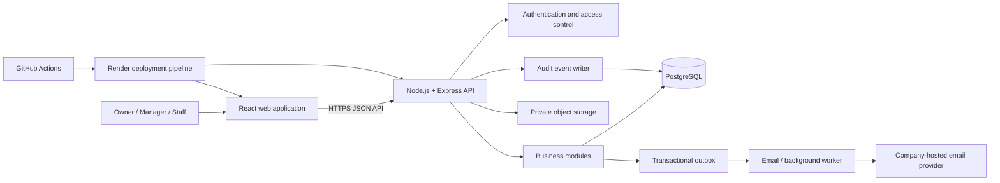

# Dscentsation Management System — Architecture Overview

**Document status:** Draft for project-manager review  
**Task:** 002 — Technical Architecture  
**Scope:** Initial internal operations platform for Dscentsation's Nigerian operations  
**Requirements source:** Repository `README.md` (read in full before this document was prepared)

> This document describes a proposed architecture. It does not indicate that an application, database, integration or deployment already exists. Decisions marked as proposed remain subject to review.

## 1. Architecture goals

DMS will provide one secure internal workspace for recording and managing Dscentsation's operational activity. The architecture must:

- Keep customer, order, payment, expense, supplier and stock records consistent.
- Support the Owner's remote oversight from the UK and day-to-day use by Managers and Staff in Nigeria.
- Track inventory by both product and physical stock location.
- Preserve a traceable history of financial and stock events.
- Keep the first release understandable and maintainable for a small team of approximately 3–5 users.
- Protect business and customer data even though the source repository is public.
- Leave room for later modules without introducing unnecessary distributed-system complexity.

The initial system is a **single-company internal application**, not a multi-tenant SaaS platform.

## 2. Confirmed product boundaries

The following are requirements, not optional architecture suggestions:

- Products are created and maintained manually in DMS.
- The existing website product catalogue is not bulk-imported or synchronised.
- DMS is not a public ecommerce storefront and will not provide public customer shopping accounts.
- Website-originated orders can be entered manually by Staff. Automatic website-order ingestion is not part of the first-release assumption.
- Orders can be recorded from WhatsApp, Instagram, the website and phone calls.
- Initial business currency is Nigerian Naira (NGN); business reporting uses the `Africa/Lagos` timezone.
- The system supports multiple physical stock locations and the Owner, Manager and Staff roles.
- Customer transactional email must use Dscentsation's official company-hosted email identity. The provider and sending method still need verification.
- WhatsApp conversation ingestion, SMS, marketing automation and AI assistants are not first-release dependencies.

## 3. Proposed system shape

Use a **modular monolith**: one React web application, one Node.js/Express API application and one PostgreSQL database. Keep business domains separated inside the codebase, while deploying the API as one service initially.

The diagram is logical, not a claim that any of these services have been provisioned.

### 3.1 Frontend — React

**Recommendation:** React with TypeScript and Vite for the internal single-page application. React is the confirmed frontend technology; TypeScript and Vite are proposed implementation choices.

Organise the frontend by business feature rather than by page alone:

| Area | Responsibilities |
|---|---|
| Application shell | Navigation, responsive layout, loading/error boundaries and session state |
| Dashboard | Sales, orders, payments, expenses, stock alerts and recent activity summaries |
| Orders and delivery | Order entry, order queue, status history, fulfilment location and delivery details |
| Products | Manual product/category/variant registration, editing and archiving |
| Inventory | Location balances, receiving, reservations, transfers, counts and adjustments |
| Customers | Customer profiles, contact details, purchase history and communication history |
| Sales and payments | Payment recording, outstanding balances, receipts and sales summaries |
| Expenses | Expense entry, evidence upload, approval queue and expense reporting |
| Suppliers and procurement | Supplier records, purchase orders, goods received and supplier payments |
| Returns and refunds | Return review, inspection outcome, refund record and stock disposition |
| Reports | Role-appropriate operational and financial reporting |
| Administration | User management, locations, permissions and business settings |

Suggested frontend boundaries:

- `app/`: application bootstrap, route configuration and global providers.
- `features/<domain>/`: domain-specific screens, components, hooks and form schemas.
- `components/`: reusable interface components with no business authority.
- `lib/api/`: one authenticated API client, typed request/response contracts and error handling.
- `lib/auth/`: current-user/session state and presentation-level route guards.
- `lib/validation/`: shared client-side form validation where appropriate.

The frontend may hide unavailable actions for usability, but it must never be the authority for access control. A user can call an API without using the interface, so every protected action must be authorised by the backend.

Use server data as the source of truth. Cache and refresh data deliberately; do not treat browser storage as the authoritative store for orders, balances or payments.

### 3.2 Backend — Node.js and Express

Use Node.js with Express and TypeScript. Expose a versioned JSON REST API under `/api/v1`.

Recommended backend layers:

1. **Routes:** map HTTP paths and methods to controllers.
2. **Middleware:** session authentication, permission checks, request IDs, rate limits and common error handling.
3. **Validation:** validate path, query and body data at the API boundary.
4. **Controllers:** translate HTTP requests/responses; keep business rules out of controllers.
5. **Services:** implement order, stock, payment, approval and other business workflows.
6. **Repositories/data access:** execute parameterised database operations and transactions.
7. **Domain events/outbox:** record work that must be delivered after a database transaction commits.

Recommended domain modules:

- Identity and access
- Customers and communications
- Product catalogue (manual DMS records only)
- Locations and inventory
- Orders and fulfilment
- Payments and refunds
- Expenses and approvals
- Suppliers and procurement
- Returns and exchanges
- Documents and file metadata
- Reporting
- Audit history

Start as one deployable API with these internal module boundaries. Do not split into microservices for a 3–5-person initial operation. A background worker may run as a separate process/service when needed for email delivery and other retryable tasks, while sharing the same domain code and database.

### 3.3 Database — PostgreSQL

PostgreSQL is the system of record for operational data.

Core principles:

- Use foreign keys, unique constraints, check constraints and database transactions to protect integrity.
- Store timestamps as timezone-aware `timestamptz` values in UTC; render business dates and times using `Africa/Lagos`.
- Store monetary values as integer minor units (kobo) with an explicit currency code. Do not use binary floating-point for money.
- Store stock quantities as `NUMERIC` with an agreed precision; do not use floating-point quantities.
- Use UUID primary keys for application entities.
- Use database migrations checked into source control. Never rely on manual production schema edits.
- Preserve transaction history. Archive products and deactivate users rather than deleting records that are referenced by business history.
- Keep stock movement and payment/refund event records append-only in normal application workflows.

A detailed conceptual schema and relationship map are in [Database Design](./database-design.md).

## 4. Critical business workflows

### 4.1 Record and fulfil an order

1. Staff selects or creates a customer and records the source channel: WhatsApp, Instagram, website or phone.
2. Staff selects exactly one fulfilment location for the order and adds manually registered products/variants, quantities, price snapshots, discounts and delivery fee.
3. All items in the order are sourced from that one location in the first release. Cross-location split fulfilment is not supported. If stock is insufficient at the selected location, the order cannot silently source missing items from another location; staff must correct the order, select another single location before confirmation where authorised, or arrange a stock transfer before fulfilment.
4. When the order is confirmed, the backend locks the selected location's relevant stock balances and reserves the required stock immediately in one database transaction. This applies whether the order is unpaid, partially paid or paid; payment is not a precondition for reservation.
5. Each reservation receives an expiry timestamp derived from the active, configurable reservation policy. The policy is stored in PostgreSQL. Policy changes apply to new reservations; changing an existing expiry requires an explicit authorised and audited action.
6. Staff may record payments. Only Managers and the Owner may verify them. Unverified entries are not counted as verified money received.
7. Processing, packing and delivery are recorded against the order's single fulfilment location.
8. At dispatch, the backend reduces on-hand stock and consumes/releases the matching reservation in one transaction, with stock movement and audit records.
9. If a reservation expires before dispatch, DMS safely releases the reserved quantity and places the order on fulfilment hold/reconfirmation. Expiry does not silently cancel the order or change physical on-hand stock.
10. Delivery attempts and completion/failure are recorded. Order, customer, payment, receipt and stock histories remain linked.

The initial reservation duration, expiry eligibility (for example, unpaid-only versus all undispatched confirmed orders), and any grace/warning policy remain configurable values to be set before implementation.

### 4.2 Receive, count and transfer inventory

- Receiving stock increases the physical balance for the chosen location and creates a corresponding movement record.
- A transfer has a source, destination, item quantities and explicit lifecycle. The source and destination must differ.
- On dispatch, source on-hand decreases and a transfer-item-specific in-transit balance increases in the same transaction. The goods are no longer available at the source and are not yet available at the destination.
- In-transit quantities remain linked to the transfer item, product variant, source and destination. The stock ledger records the source-location decrease and the in-transit increase.
- A Staff user assigned to the destination location must confirm receipt. In one transaction, the system reduces in-transit quantity and increases destination on-hand, and records paired ledger events and an audit event. Source Staff cannot confirm destination receipt on the destination team's behalf.
- Partial receipt reduces the in-transit balance only by the quantity actually confirmed. Unreceived quantities remain in transit until received or formally resolved through a discrepancy workflow.
- Shortage/damage discrepancies require a reason, staff attribution and review; unresolved quantity remains visible as in transit and cannot be silently written off.
- Managers can view and manage stock across all locations. Staff may act only at locations assigned to that Staff account.
- Adjustments, damage, loss and returns must create attributable movement records.
- Physical and in-transit balances are transactional summaries; the append-only movement ledger provides the traceable history.

### 4.3 Record payment and refund activity

Payment entries are separate financial events linked to orders. Staff may record payment details, including amount, date, method and reference. Only Managers and the Owner may verify a recorded payment. Until verified, an entry remains unverified and is excluded from verified-receipts totals and calculations that represent money actually received.

Corrections are represented by reversal or adjustment events, not silent overwriting. The first release is a manual operational payment-recording model; it does not assume a payment gateway or automated bank reconciliation.

### 4.4 Send transactional email

Create an email-outbox entry in the same database transaction as the business event that requires a message. A worker then sends the message through an adapter configured for Dscentsation's verified company-hosted email provider.

Receipt issuance is a separate business record from sending an email. When a receipt is issued, DMS creates an immutable receipt-issuance record with a unique receipt reference, order/payment association where relevant, issuer, timestamp, currency/amount and frozen transaction snapshot. Email delivery attempts reference that issuance record; failed email delivery does not erase or reverse the issued receipt.

This avoids losing an email request if the API process stops after committing an order. Workers must retry temporary failures safely, use idempotency/deduplication keys, and record provider outcomes. A failed email must not roll back an otherwise valid order or payment.

Email credentials belong only in backend secret configuration. The frontend must never receive SMTP passwords, provider tokens or unrestricted email credentials.

## 5. Authentication and authorisation

Use individual user accounts; do not share a common Staff login.

**Authentication and session requirements:**

- Invite/provision users rather than permit unrestricted public registration.
- Hash passwords with a modern password-hashing function such as Argon2id.
- Use opaque server-side sessions delivered through secure, HttpOnly, SameSite cookies.
- Persist session records in PostgreSQL through a PostgreSQL-backed Express session store. Create/manage its table through migrations and index the expiry field for lookup and cleanup.
- Production must never use Express MemoryStore, any in-memory session store or process-local session state. All API instances share the same PostgreSQL-backed store so sessions survive process restarts and work across instances.
- Rotate session identifiers after authentication/privilege changes and support revocation on logout, password reset, account suspension and suspected compromise.
- Require HTTPS in hosted environments; apply CSRF protection to cookie-authenticated state-changing requests.
- Add login throttling, generic authentication errors and short-lived, single-use password-reset tokens.
- Record sign-in/security events without logging passwords, reset tokens, session IDs or session secrets.

**Confirmed role, location and payment rules:**

| Role | Business and location access | Payment permissions |
|---|---|---|
| Owner | Full business oversight and access to all stock locations. | Can record and verify payments. |
| Manager | Day-to-day management and access to all stock locations. | Can record and verify payments. |
| Staff | Task-based access and stock actions only at locations explicitly assigned to that Staff account. | Can record payments but cannot verify them. |

Enforce these rules in backend middleware and domain services with deny-by-default behaviour. Manager access to all locations is global and does not depend on user-location assignment rows. Staff location assignments must be checked on every location-scoped request, including stock reads, order fulfilment actions, transfer dispatch and destination receipt confirmation. A Staff user may confirm a transfer receipt only when assigned to that transfer's destination location.

The detailed permission matrix for other modules (such as exports, refunds, expense approvals and user administration) can be refined separately, but it must not weaken the confirmed role/location/payment rules.

## 6. Email, file storage and other integrations

### Company-hosted email

Implement an email-provider adapter so SMTP or an email API can be selected after the current company-hosted account is verified. Verify sender authentication, sending limits, supported SMTP/API method, TLS requirements, delivery/bounce visibility and any account restrictions before implementation.

Use only the official Dscentsation sender identity for transactional messages. Store message type, recipient, related order/customer, send attempts, provider reference and outcome. Keep marketing consent separate from transactional email preference.

### File storage

Use Supabase Storage or an equivalent private object-storage service, consistent with the README proposal. Store file bytes outside PostgreSQL and store only metadata/object keys in the database.

- Private buckets/containers by default.
- Authorise every upload and download on the backend.
- Issue short-lived signed URLs only after permission checks.
- Validate file size and allowed content type; use generated object keys, not user-supplied paths.
- Store uploader, purpose, related record, content type, size and checksum.
- Do not expose permanent public URLs for receipts, supplier files, customer documents or expense evidence.

### Out-of-scope integrations

No product-catalogue import/synchronisation, WhatsApp/Instagram conversation ingestion, SMS provider or payment gateway is assumed for the first release. Website orders are manually entered. Each later integration needs a separate scope and security review.

## 7. Auditability and data protection

Maintain an append-only audit log for sensitive operations, including user/security changes, product changes, order state changes, approvals, payment/refund events, stock receiving/dispatch/transfers/adjustments and document access where appropriate.

An audit event should identify the actor, action, entity, entity ID, timestamp, request/correlation ID and a safe summary of changed fields. Avoid copying secrets, full payment credentials or unnecessary customer data into audit metadata.

Other safeguards:

- Keep production customer and financial data out of GitHub and test fixtures.
- Use environment/secret management for database, email and storage credentials.
- Use parameterised queries and strict input validation.
- Apply least privilege to application/database/storage credentials.
- Apply request-size limits, security headers, CORS allowlists and API rate limits.
- Encrypt traffic in transit and use the hosting/database provider's encryption-at-rest capabilities.
- Restrict file access and retain only necessary customer information.
- Establish backup, restore and incident-response procedures before production use.
- Log operational errors with request IDs while redacting personal data and secrets.

Privacy notices, retention periods, deletion/correction handling and the applicable legal compliance review need business-owner approval before launch.

## 8. Testing architecture

Testing must cover business invariants, not just successful page rendering.

| Test layer | Coverage | Suggested tooling |
|---|---|---|
| Frontend unit/component | Form validation, permissions-based presentation, totals and component states | Vitest, React Testing Library |
| Backend unit | Domain rules, role checks, order/payment status transitions and validation | Vitest or Jest |
| API integration | Express routes, authentication, authorisation and PostgreSQL queries | Supertest with an isolated test database |
| Database/invariant | Constraints, migrations, transaction rollback, concurrent reservations/transfers and idempotency | PostgreSQL test instance; controlled concurrency tests |
| End-to-end | Login, manual product creation, order fulfilment, payment recording, transfer, approvals and reports | Playwright |
| Security | Unauthorised access, location boundary checks, session/CSRF/rate-limit behaviour and unsafe uploads | Automated security tests plus manual review |

Required high-risk tests include:

- Two concurrent orders cannot reserve the same unavailable stock.
- Confirming an order twice cannot reserve twice.
- Cancelling an order releases a reservation once.
- Dispatch reduces on-hand and reserved quantities consistently.
- A transfer cannot create stock at the destination before receipt is confirmed.
- A payment/refund correction preserves its event history.
- Staff cannot access an unassigned location or restricted Owner/Manager actions.
- Retrying an email job does not send duplicate receipts.
- Historical order lines remain accurate after a product is edited or archived.

Use synthetic customer, payment and stock data in all development and automated tests.

## 9. Deployment and operations architecture

The project manager has confirmed Render Postgres as the preferred database option, subject to verification of backups, recovery and total cost before provisioning.

| Component | Proposed deployment |
|---|---|
| React application | Render static site (or equivalent Render-hosted frontend) |
| Express API | Render web service |
| PostgreSQL | Render Postgres preferred, subject to backup/restore, recovery and cost verification |
| Session store | Persistent PostgreSQL-backed session store shared by all API instances; no production in-memory store |
| Background worker | Render worker service if/when asynchronous email and reservation-expiry processing are introduced |
| File objects | Private Supabase Storage bucket or approved equivalent |
| CI | GitHub Actions for checks on pull requests and protected branches |

Before approving Render Postgres, verify backup frequency and retention, point-in-time recovery support/limits, the actual restore procedure, and perform or document a restore test. Agree recovery objectives (RPO/RTO), verify region/private-network suitability, connection/storage/compute limits and calculate total recurring cost at expected capacity, including database, backup/recovery-related charges, frontend/API/worker services and required plan tiers. Record the findings and obtain project-manager approval. Render Postgres remains preferred, not yet approved for production provisioning until these checks pass.

Use separate development/test, staging and production configuration. Keep production secrets out of repository files and frontend build variables. Run database migrations as a controlled deployment step before the new backend version handles traffic. Do not run schema migrations automatically from every application instance at startup.

CI should run formatting/lint checks, TypeScript checks, unit/integration tests and production builds. Production deployment should be gated by review and acceptance testing. Add health/readiness checks, structured logs, error monitoring, database backup/restore procedures and an operational owner for alerts.

Production API instances must use the shared PostgreSQL-backed session store. Reservation expiry should run through a retry-safe scheduled/background worker using the same PostgreSQL transaction rules as order dispatch and cancellation.

No service is provisioned and no deployment is part of this task.

## 10. Phased implementation boundaries

The architecture supports the README roadmap:

1. Foundation: repository structure, configuration, migrations, authentication, roles, audit and application shell.
2. Products and inventory: manual products, locations, balances, movements, reservations, transfers and counts.
3. Customers and orders: customer records, order channels, order workflow, delivery and payment records.
4. Communications: receipts and verified company email sending.
5. Finance: sales reports, expenses and approvals.
6. Suppliers, procurement, returns and refunds.
7. Reporting, hardening, deployment and acceptance testing.

Future AI, marketing automation, WhatsApp/SMS integrations and website-order ingestion are deferred. No architecture decision here authorises product-catalogue import or a public storefront.

## 11. Review gates and unresolved questions

The following project-manager decisions are confirmed and no longer open questions:

- Destination Staff assigned to the destination location must confirm stock-transfer receipt.
- Staff may record payment entries; only Managers and the Owner may verify payments.
- Managers have access to all stock locations; Staff are restricted to assigned locations.
- Render Postgres is preferred, subject to backup, recovery and cost verification.
- Each order has exactly one fulfilment location in the first release.
- Stock is reserved immediately when an order is confirmed, even if unpaid.
- Reservation expiry must be configurable.

Remaining questions before implementation:

1. What are the actual stock locations, codes and Staff-to-location assignments?
2. What initial reservation duration should be configured, and should expiry apply only to unpaid orders or to all undispatched confirmed orders?
3. Should a grace period, warning notification or reminder precede expiry?
4. What exception/escalation process applies if destination Staff are unavailable, or if a transfer has a shortage/damage discrepancy?
5. What are the detailed permission/approval rules for refunds, expense approvals, exports and user administration?
6. Which company-hosted email provider and supported SMTP/API sending method will be used?
7. What are the receipt format, numbering rules and record-retention requirements?
8. What are the file-storage provider/region, allowed file types, maximum file sizes and retention rules?
9. Do Render Postgres backup, recovery and cost checks meet the business's expectations?

**Review outcome:** Pending. This architecture reflects the confirmed project-manager rules but is not permission to start application implementation or deployment.