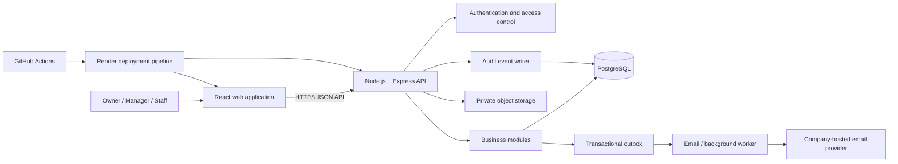

# Dscentsation Management System — Architecture Overview

**Document status:** Implementation-aware architecture draft; proposed technical decisions remain subject to their recorded review status
**Task:** 002 — Technical Architecture, reconciled against Task 005

**Scope:** Initial internal operations platform for Dscentsation's Nigerian operations
**Requirements and implementation sources:** Repository `README.md`, Task 005 merge commit `652b5d51d17ecb36e78871a99164c12238a8ac41`, application manifests, source, migration and CI workflow

> This document distinguishes confirmed product/business rules, the merged Task 005 foundation, Task 007 Product Management and Task 008 Employee Account Administration implementations in `main`, and target architecture that remains proposed or requires confirmation. Implementing a proposed choice does not by itself ratify that architecture decision. No production infrastructure or deferred business-module workflow is implied.

## 1. Architecture goals

DMS will provide one secure internal workspace for recording and managing Dscentsation's operational activity. The architecture must:

- Keep customer, order, payment, expense, supplier and stock records consistent.
- Support the Owner's remote oversight from the UK and day-to-day use by Managers and Staff in Nigeria.
- Track inventory by both product and physical stock location.
- Preserve a traceable history of financial and stock events.
- Keep the first release understandable and maintainable for a small team of approximately 3–5 users.
- Protect business and customer data even though the source repository is public.
- Leave room for later modules without introducing unnecessary distributed-system complexity.

The initial system is a **single-company internal application**, not a multi-tenant SaaS platform.

### Task 005 implemented foundation (merged PR #7)

The following is implementation evidence from the current `main` branch, not a blanket architecture approval:

- A pnpm 12.16.1 workspace/monorepo contains separate `apps/web` and `apps/api` applications. The root engine pins Node.js 26.13.0.
- The web application uses React 19.3.0, TypeScript 6.0.3 and Vite 8.3.5. Its implemented scope includes the responsive sign-in experience, authenticated application shell, dashboard shell, Product Management and Owner-facing Employee Account Administration.
- The API uses Node.js, Express 5.3.0 and TypeScript 6.0.3. It exposes a versioned JSON API under `/api/v1`; current routes cover health, authentication/session/capability operations, Product Management and Employee Account Administration.
- PostgreSQL is accessed through `pg` 8.23.1 using explicit parameterised SQL. `node-pg-migrate` 9.0.0 manages migrations. There is no ORM in the Task 005 implementation.
- Migration 001 creates the eight Task 005 foundation tables: `roles`, `permissions`, `role_permissions`, `users`, `locations`, `user_location_access`, `user_sessions` and `audit_logs`. Merged migration 002 adds the three Product Management tables. Merged Task 008 migration 003 adds `user_invitations`, the invited account state and last-active-Owner protection; see [Database Design](./database-design.md).
- Task 005 authentication uses Argon2id, provisioned accounts, `connect-pg-simple` PostgreSQL sessions, secure cookie configuration, login session rotation, logout/revocation, expiry handling, exact-Origin and session-bound CSRF validation, login throttling and an interactive Owner bootstrap CLI. Task 008 extends the foundation with an Owner-only employee directory, Manager/Staff invitation and initial password setup, suspension/reactivation and atomic employee-session revocation.
- Migration 001 seeds Owner, Manager and Staff plus the four foundation permission codes. Migration 002 adds six Owner-only `products.*` permissions. Task 008 migration 003 adds Owner-only `users.view` and `users.manage`; Manager and Staff receive neither. Audit rows remain protected against UPDATE, DELETE and TRUNCATE by PostgreSQL triggers.
- CI uses GitHub Actions for pull requests targeting `main` and pushes to `main`. The current baseline includes Prettier, ESLint, TypeScript checks, Vitest, Supertest, React Testing Library, PostgreSQL-backed integration tests, migration/seed/rollback/reapplication checks and production builds.

The repository structure is consistent with the proposed modular-monolith direction, but ADR-001 remains Proposed. TypeScript/Vite/API details, database tooling and test-strategy ratification retain their existing decision-register statuses. No production host/database, background worker, email provider, file-storage service or deployment has been provisioned. Task 008 does not send email: it returns a one-time invitation URL for manual delivery through the official company email identity while DMS-DEC-017 remains pending. Location assignments remain out of scope under DMS-DEC-001, and the complete role/permission matrix remains unresolved under DMS-DEC-002.

## 2. Confirmed product boundaries

The following are requirements, not optional architecture suggestions:

- Products are created and maintained manually in DMS.
- The existing website product catalogue is not bulk-imported or synchronised.
- DMS is not a public ecommerce storefront and will not provide public customer shopping accounts.
- Website-originated orders can be entered manually by Staff. Automatic website-order ingestion is not part of the first-release assumption.
- Orders can be recorded from WhatsApp, Instagram, the website and phone calls.
- Initial business currency is Nigerian Naira (NGN); business reporting uses the `Africa/Lagos` timezone.
- The system supports multiple physical stock locations and the Owner, Manager and Staff roles.
- Customer transactional email must use Dscentsation's official company-hosted email identity. The provider and sending method still need verification.
- WhatsApp conversation ingestion, SMS, marketing automation and AI assistants are not first-release dependencies.

## 3. Target application architecture beyond the foundation

The Task 005 codebase is organised as a pnpm monorepo with separate React web and Node.js/Express API applications, backed by PostgreSQL access. This structure is consistent with a **modular-monolith proposal**, but ADR-001 remains Proposed until the architecture is formally reviewed. The target design keeps business domains separated inside the codebase and proposes one API deployment initially.

The diagram is a logical target, not a record of deployed services. Task 005 implemented the web/API code, PostgreSQL access and CI workflow only. The transactional outbox, background worker, company email provider, private object storage, Render deployment pipeline and hosted application/database services shown or described as target components have not been provisioned.

### 3.1 Frontend — React

**Task 005 implementation:** The internal web application uses React 19.3.0, TypeScript 6.0.3 and Vite 8.3.5. React remains the established frontend framework; TypeScript and Vite are adopted in the codebase but remain subject to formal ratification under ADR-002 / DMS-DEC-022. The current UI is limited to sign-in, the authenticated shell, placeholder navigation and an initial dashboard shell.

Organise the frontend by business feature rather than by page alone:

| Area | Responsibilities |
|---|---|
| Application shell | Navigation, responsive layout, loading/error boundaries and session state |
| Dashboard | Sales, orders, payments, expenses, stock alerts and recent activity summaries |
| Orders and delivery | Order entry, order queue, status history, fulfilment location and delivery details |
| Products | Manual product/category/variant registration, editing and archiving |
| Inventory | Location balances, receiving, reservations, transfers, counts and adjustments |
| Customers | Customer profiles, contact details, purchase history and communication history |
| Sales and payments | Payment recording, outstanding balances, receipts and sales summaries |
| Expenses | Expense entry, evidence upload, approval queue and expense reporting |
| Suppliers and procurement | Supplier records, purchase orders, goods received and supplier payments |
| Returns and refunds | Return review, inspection outcome, refund record and stock disposition |
| Reports | Role-appropriate operational and financial reporting |
| Administration | User management, locations, permissions and business settings |

Suggested frontend boundaries:

- `app/`: application bootstrap, route configuration and global providers.
- `features/<domain>/`: domain-specific screens, components, hooks and form schemas.
- `components/`: reusable interface components with no business authority.
- `lib/api/`: one authenticated API client, typed request/response contracts and error handling.
- `lib/auth/`: current-user/session state and presentation-level route guards.
- `lib/validation/`: shared client-side form validation where appropriate.

The frontend may hide unavailable actions for usability, but it must never be the authority for access control. A user can call an API without using the interface, so every protected action must be authorised by the backend.

Use server data as the source of truth. Cache and refresh data deliberately; do not treat browser storage as the authoritative store for orders, balances or payments.

### 3.2 Backend — Node.js and Express

The API implementation uses Node.js 26.13.0, Express 5.3.0 and TypeScript 6.0.3, with a versioned JSON REST API under `/api/v1`. These implementation details are recorded as adopted in the codebase; formal ratification remains open under ADR-003 / DMS-DEC-023. Current routes cover health and authentication/session/capability operations only.

Recommended backend layers:

1. **Routes:** map HTTP paths and methods to controllers.
2. **Middleware:** session authentication, permission checks, request IDs, rate limits and common error handling.
3. **Validation:** validate path, query and body data at the API boundary.
4. **Controllers:** translate HTTP requests/responses; keep business rules out of controllers.
5. **Services:** implement order, stock, payment, approval and other business workflows.
6. **Repositories/data access:** execute parameterised database operations and transactions.
7. **Domain events/outbox:** record work that must be delivered after a database transaction commits.

Recommended domain modules:

- Identity and access
- Customers and communications
- Product catalogue (manual DMS records only)
- Locations and inventory
- Orders and fulfilment
- Payments and refunds
- Expenses and approvals
- Suppliers and procurement
- Returns and exchanges
- Documents and file metadata
- Reporting
- Audit history

Start as one deployable API with these internal module boundaries. Do not split into microservices for a 3–5-person initial operation. A background worker may run as a separate process/service when needed for email delivery and other retryable tasks, while sharing the same domain code and database.

### 3.3 Database — PostgreSQL

PostgreSQL is the intended system of record and is the database technology used by the Task 005 API implementation. The API uses `pg` 8.23.1 with explicit parameterised SQL; migrations use `node-pg-migrate` 9.0.0. No ORM is included. These codebase choices remain subject to formal ratification under ADR-004 / DMS-DEC-024. The current physical migration contains only the eight foundation tables listed in [Database Design](./database-design.md); business-domain tables remain conceptual proposals.

Core principles:

- Use foreign keys, unique constraints, check constraints and database transactions to protect integrity.
- Store timestamps as timezone-aware `timestamptz` values in UTC; render business dates and times using `Africa/Lagos`.
- Store monetary values as integer minor units (kobo) with an explicit currency code. Do not use binary floating-point for money.
- Store stock quantities as `NUMERIC` with an agreed precision; do not use floating-point quantities.
- Use UUID primary keys for application entities.
- Use database migrations checked into source control. Never rely on manual production schema edits.
- Preserve transaction history. Archive products and deactivate users rather than deleting records that are referenced by business history.
- Keep stock movement and payment/refund event records append-only in normal application workflows.

A detailed conceptual schema and relationship map are in [Database Design](./database-design.md).

## 4. Critical business workflows

### 4.1 Record and fulfil an order

1. Staff selects or creates a customer and records the source channel: WhatsApp, Instagram, website or phone.
2. Staff selects exactly one fulfilment location for the order and adds manually registered products/variants, quantities, price snapshots, discounts and delivery fee.
3. All items in the order are sourced from that one location in the first release. Cross-location split fulfilment is not supported. If stock is insufficient at the selected location, the order cannot silently source missing items from another location; staff must correct the order, select another single location before confirmation where authorised, or arrange a stock transfer before fulfilment.
4. When the order is confirmed, the backend locks the selected location's relevant stock balances and reserves the required stock immediately in one database transaction. This applies whether the order is unpaid, partially paid or paid; payment is not a precondition for reservation.
5. Each reservation receives an expiry timestamp derived from the active, configurable reservation policy. The policy is stored in PostgreSQL. Policy changes apply to new reservations; changing an existing expiry requires an explicit authorised and audited action.
6. Staff may record payments. Only Managers and the Owner may verify them. Unverified entries are not counted as verified money received.
7. Processing, packing and delivery are recorded against the order's single fulfilment location.
8. At dispatch, the backend reduces on-hand stock and consumes/releases the matching reservation in one transaction, with stock movement and audit records.
9. If a reservation expires before dispatch, DMS safely releases the reserved quantity and places the order on fulfilment hold/reconfirmation. Expiry does not silently cancel the order or change physical on-hand stock.
10. Delivery attempts and completion/failure are recorded. Order, customer, payment, receipt and stock histories remain linked.

The initial reservation duration, expiry eligibility (for example, unpaid-only versus all undispatched confirmed orders), and any grace/warning policy remain configurable values to be set before implementation.

### 4.2 Receive, count and transfer inventory

- Receiving stock increases the physical balance for the chosen location and creates a corresponding movement record.
- A transfer has a source, destination, item quantities and explicit lifecycle. The source and destination must differ.
- On source dispatch, source on-hand decreases and a transfer-item-specific in-transit balance increases in the same transaction. The goods are no longer available at the source and are not yet available at the destination.
- In-transit quantities remain linked to the transfer item, product variant, source and destination. The stock ledger records the source-location decrease and the in-transit increase.
- Destination receipt is confirmed by an authenticated operational user assigned to the destination location and holding the explicit receipt action permission. The assigned Sheraton Store Manager using the existing Manager role is eligible when those checks pass; a literal Staff-role-only check must not block this assigned responsibility. In one transaction, the system reduces in-transit quantity and increases destination on-hand, and records paired ledger events and an audit event.
- Partial receipt reduces the in-transit balance only by the quantity physically received. Unreceived quantities remain in transit until received or formally resolved through a discrepancy workflow.
- Shortage/damage discrepancies require a reason, staff attribution and review. Unresolved quantities remain visible in the transfer/in-transit ledger and cannot be silently written off.
- Authorised operational users share read-only visibility of both Ajose Warehouse and Sheraton Store operational dashboards, stock quantities and availability. A non-Owner's direct stock-changing operations are limited to the location assigned to that account; shared visibility is not shared write access. Cross-location stock-changing requests use the pending approval process in §5, except for the separately governed transfer, pickup and destination-receipt workflows.
- Adjustments, damage, loss and returns must create attributable movement records.
- Physical and in-transit balances are transactional summaries; the append-only movement ledger provides the traceable history.

#### 4.2.1 Dedicated Warehouse-to-Sheraton pickup and destination receipt under shared visibility

Ajose Warehouse and Sheraton Store are separate physical stock locations with independent balances. Authorised operational users may view both locations' operational dashboards, stock quantities and availability. The assigned Sheraton Store Manager may perform the dedicated pickup and destination-receipt actions when the account has an active Sheraton assignment and the explicit action permission. This does not grant general Warehouse stock-changing permissions.

1. **Open or create the pickup transfer:** An operational user assigned to Sheraton and holding the explicit pickup permission may create or open a transfer only when its source is Ajose Warehouse and its destination is that user's assigned Sheraton Store. Eligibility is action-permission and assignment based; it must not depend exclusively on a literal `STAFF` role check.
2. **Record what was physically collected:** At Warehouse, the authorised destination-assigned user records the actual collected quantity against each transfer item. Shared stock dashboards remain read-only; the pickup command does not give the actor general Warehouse editing, receiving, adjustment or unrelated transfer permissions.
3. **Validate and post pickup atomically:** The backend loads the transfer and assignment from trusted database records, locks the relevant transfer/item and Warehouse balance rows, and verifies the exact source/destination, actor assignment, action permission, transfer state, item remainder and current Warehouse available stock. In one transaction it reduces Warehouse on-hand, increases the transfer item's in-transit balance, appends Warehouse-out and in-transit-in movement events, records the pickup event and actor, and updates cumulative picked quantity/status.
4. **Preserve shared visibility without broadening write access:** The normal authorised operational read surfaces may show Warehouse quantities and availability to the Sheraton Store Manager and Warehouse Staff. The pickup action remains limited to its exact transfer and must not be used to change Warehouse stock outside that transfer. A stock validation failure must not partially post the submitted event.
5. **Confirm physical receipt at Sheraton:** An operational user assigned to the destination Sheraton Store and holding the explicit destination-receipt permission records the actual quantity received. The existing Manager role is eligible where the destination assignment and permission are satisfied. The same person may perform pickup and receipt. In one transaction the backend decreases in-transit quantity, increases Sheraton on-hand, appends paired movement events, records the receipt event and actor, and updates cumulative received quantity/status.
6. **Close only when accounted for:** A transfer is complete only when all picked quantities have been received or formally resolved. Pickup and receipt actors/timestamps remain in separate immutable event history.

This capability is a resource/action permission, not a general Warehouse write grant. Standard stock transfers, dedicated physical pickup and destination receipt are separate workflows and do not enter the additional cross-location stock-change approval queue. All other non-Owner stock-changing requests that affect the other location require the destination-location approval described in §5.

### 4.3 Record payment and refund activity

Payment entries are separate financial events linked to orders. Staff may record payment details, including amount, date, method and reference. Only Managers and the Owner may verify a recorded payment. Until verified, an entry remains unverified and is excluded from verified-receipts totals and calculations that represent money actually received.

Corrections are represented by reversal or adjustment events, not silent overwriting. The first release is a manual operational payment-recording model; it does not assume a payment gateway or automated bank reconciliation.

### 4.4 Send transactional email

Create an email-outbox entry in the same database transaction as the business event that requires a message. A worker then sends the message through an adapter configured for Dscentsation's verified company-hosted email provider.

Receipt issuance is a separate business record from sending an email. When a receipt is issued, DMS creates an immutable receipt-issuance record with a unique receipt reference, order/payment association where relevant, issuer, timestamp, currency/amount and frozen transaction snapshot. Email delivery attempts reference that issuance record; failed email delivery does not erase or reverse the issued receipt.

This avoids losing an email request if the API process stops after committing an order. Workers must retry temporary failures safely, use idempotency/deduplication keys, and record provider outcomes. A failed email must not roll back an otherwise valid order or payment.

Email credentials belong only in backend secret configuration. The frontend must never receive SMTP passwords, provider tokens or unrestricted email credentials.

## 5. Authentication and authorisation

Use individual user accounts; do not share a common Staff login.

**Authentication and session requirements:**

- Invite/provision users rather than permit unrestricted public registration.
- Hash passwords with a modern password-hashing function such as Argon2id.
- Use opaque server-side sessions delivered through secure, HttpOnly, SameSite cookies.
- Persist session records in PostgreSQL through a PostgreSQL-backed Express session store. Create/manage its table through migrations and index the expiry field for lookup and cleanup.
- Production must never use Express MemoryStore, any in-memory session store or process-local session state. All API instances share the same PostgreSQL-backed store so sessions survive process restarts and work across instances.
- Rotate session identifiers after authentication/privilege changes and support revocation on logout, password reset, account suspension and suspected compromise.
- Require HTTPS in hosted environments; apply CSRF protection to cookie-authenticated state-changing requests.
- Add login throttling, generic authentication errors and short-lived, single-use password-reset tokens.
- Record sign-in/security events without logging passwords, reset tokens, session IDs or session secrets.

**Role, location, payment and financial-visibility direction (Task 010 planning direction for the revised access rules; formal confirmation remains pending under DMS-DEC-001/002):**

| Role | Shared operational visibility | Direct stock-changing operations | Other permission boundary |
|---|---|---|---|
| Owner | Both location dashboards, stock quantities/availability and all business areas. | Both Ajose Warehouse and Sheraton Store without location restriction or second approval. | May approve/reject/override another user's pending cross-location request. Owner-only consolidated financial overview across both locations. Can record and verify payments. |
| Manager (Sheraton Store Manager assignment) | Both location dashboards, stock quantities/availability and shared operational information. | Sheraton Store only, as assigned. May use the dedicated Warehouse-to-assigned-Sheraton pickup and destination-receipt actions only with the explicit action permissions and active Sheraton assignment. The Manager role alone does not grant unrestricted Warehouse stock editing. | Can record and verify payments under the existing payment rule. No Owner-only consolidated financial overview. |
| Staff (Ajose Warehouse assignment) | Both location dashboards, stock quantities/availability and shared operational information. | Ajose Warehouse only, as assigned. A stock-changing request affecting Sheraton requires approval from the Sheraton Store Manager. | Can record payments but cannot verify them. No Owner-only consolidated financial overview. |

**Shared visibility and location-scoped editing:** Operational read access is not the same as write permission. All authorised operational users may view both initial locations and their stock quantities/availability. A non-Owner may carry out normal authorised stock-changing operations directly only at the location assigned to that account. Do not grant the generic Manager role unrestricted cross-location stock editing. Assignment details must be resolved and checked server-side.

**Cross-location stock-change approval:** When a non-Owner requests a stock-changing operation against the other location, create a request in **Pending Approval** and do not change the live stock balance. A Sheraton Store Manager request affecting Ajose Warehouse requires approval by any one authorised Ajose Warehouse Staff account. An Ajose Warehouse Staff request affecting Sheraton Store requires approval by the Sheraton Store Manager. The requester cannot approve their own request. The Owner may approve, reject or override another user's pending request; Owner operations performed directly at either location need no additional approval. The request retains the requester, target location, proposed operation, reason and submission time; the decision retains the approver, decision, decision time and outcome. Approval revalidates current permissions and stock state before the approved movement and balance update are committed transactionally. Rejection creates no stock change. Every request, decision and override is attributable and auditable. The cross-location approval rule covers manual stock adjustments/corrections, stock receiving that changes the target location's balance, stock-count reconciliation and other non-transfer stock operations that change quantities. Non-Owner reservation or dispatch operations that change stock at a location other than the actor's assigned location are also subject to this approval rule, including when they form part of an order workflow. The only separate workflow exceptions are standard stock transfers, the dedicated Ajose Warehouse-to-Sheraton Store physical pickup, and destination receipt for those transfer workflows. These transfer workflows remain governed by their separate lifecycles and do not enter this additional approval queue.

### Task 005 authentication implementation and limitations

The merged foundation implements Argon2id password hashing and provisioned accounts; public self-registration is not provided. Sessions use `express-session` with `connect-pg-simple` 10.0.0 and the migrated `user_sessions` table. The cookie is HttpOnly and SameSite=Lax, with the Secure flag controlled by configuration and required in production. Login regenerates the session identifier; logout destroys the session; a user-session revocation helper is present. The API enforces an absolute session age and the cookie/store applies the configured idle expiry.

State-changing requests require an exact configured Origin and a session-bound CSRF token. Login attempts are throttled by `express-rate-limit`; the current limiter is process-local and is not a shared distributed rate limiter. Production security configuration requires explicit idle and absolute timeout values, secure cookies and an HTTPS application origin; the values in development examples are not approved production policy. Production has no in-memory session-store fallback.

The initial Owner bootstrap is an interactive CLI operation. It prompts for credentials without echoing the password, prevents a second Owner, uses a transaction/advisory lock and records the bootstrap in audit history.

MFA has not been implemented or approved. Production idle/absolute lifetime values, concurrent-session policy and high-risk-action re-authentication remain unresolved. These limitations are tracked in DMS-DEC-025 and DMS-DEC-026; do not treat them as completed features. The four seeded permission codes and seven assignments are only the existing foundation subset, not the complete business permission matrix. The current Task 005 access helper grants the generic Manager role global stock-location access, and the current pickup helper is Staff-role-specific; those are code facts, not the revised target model. Task 010 is documentation-only. A later reviewed implementation task must reconcile the helper and action checks with location-scoped Manager editing and assigned-Manager pickup/receipt eligibility without adding role codes or general Warehouse write access.

## 6. Email, file storage and other integrations

### Company-hosted email

Implement an email-provider adapter so SMTP or an email API can be selected after the current company-hosted account is verified. Verify sender authentication, sending limits, supported SMTP/API method, TLS requirements, delivery/bounce visibility and any account restrictions before implementation.

Use only the official Dscentsation sender identity for transactional messages. Store message type, recipient, related order/customer, send attempts, provider reference and outcome. Keep marketing consent separate from transactional email preference.

### File storage

Use Supabase Storage or an equivalent private object-storage service, consistent with the README proposal. Store file bytes outside PostgreSQL and store only metadata/object keys in the database.

- Private buckets/containers by default.
- Authorise every upload and download on the backend.
- Issue short-lived signed URLs only after permission checks.
- Validate file size and allowed content type; use generated object keys, not user-supplied paths.
- Store uploader, purpose, related record, content type, size and checksum.
- Do not expose permanent public URLs for receipts, supplier files, customer documents or expense evidence.

### Out-of-scope integrations

No product-catalogue import/synchronisation, WhatsApp/Instagram conversation ingestion, SMS provider or payment gateway is assumed for the first release. Website orders are manually entered. Each later integration needs a separate scope and security review.

## 7. Auditability and data protection

Maintain an append-only audit log for sensitive operations, including user/security changes, product changes, order state changes, approvals, payment/refund events, stock receiving/dispatch/transfers/adjustments and document access where appropriate.

An audit event should identify the actor, action, entity, entity ID, timestamp, request/correlation ID and a safe summary of changed fields. Avoid copying secrets, full payment credentials or unnecessary customer data into audit metadata.

Other safeguards:

- Keep production customer and financial data out of GitHub and test fixtures.
- Use environment/secret management for database, email and storage credentials.
- Use parameterised queries and strict input validation.
- Apply least privilege to application/database/storage credentials.
- Apply request-size limits, security headers, CORS allowlists and API rate limits.
- Encrypt traffic in transit and use the hosting/database provider's encryption-at-rest capabilities.
- Restrict file access and retain only necessary customer information.
- Establish backup, restore and incident-response procedures before production use.
- Log operational errors with request IDs while redacting personal data and secrets.

Privacy notices, retention periods, deletion/correction handling and the applicable legal compliance review need business-owner approval before launch.

## 8. Testing architecture

Testing must cover business invariants, not just successful page rendering.

| Test layer | Coverage | Suggested tooling |
|---|---|---|
| Frontend unit/component | Form validation, permissions-based presentation, totals and component states | Vitest, React Testing Library |
| Backend unit | Domain rules, role checks, order/payment status transitions and validation | Vitest or Jest |
| API integration | Express routes, authentication, authorisation and PostgreSQL queries | Supertest with an isolated test database |
| Database/invariant | Constraints, migrations, transaction rollback, concurrent reservations/transfers and idempotency | PostgreSQL test instance; controlled concurrency tests |
| End-to-end | Login, manual product creation, order fulfilment, payment recording, transfer, approvals and reports | Playwright |
| Security | Unauthorised access, location boundary checks, session/CSRF/rate-limit behaviour and unsafe uploads | Automated security tests plus manual review |

Required high-risk tests include:

- Two concurrent orders cannot reserve the same unavailable stock.
- Confirming an order reserves stock immediately even when the order is unpaid; confirming twice cannot reserve twice.
- An order reserves all its items at its single fulfilment location and cannot silently source from another location.
- Cancelling an order releases a reservation once.
- Reservation expiry releases reserved quantity (not on-hand stock) once, only when due and policy-eligible; it must not cancel the order or race with dispatch/cancellation into a double release/consume.
- A reservation-policy change affects new reservations only; existing reservations keep their original policy version and expiry unless explicitly changed and audited.
- A normal transfer dispatch reduces source stock and creates in-transit quantity; destination stock does not increase until destination Staff confirms receipt.
- An operational user assigned to Sheraton and holding the explicit pickup permission can create/open and record pickup only for a Warehouse-to-that-assigned-Sheraton transfer. The assigned Store Manager using the existing Manager role is eligible where the destination assignment and action permission checks pass; this does not grant general Warehouse write access.
- The Sheraton pickup action validates the transfer and assignment server-side and atomically reduces Warehouse on-hand while increasing in-transit quantity.
- An operational user assigned to Sheraton and holding the explicit destination-receipt permission can confirm receipt; the assigned Store Manager is eligible where those checks pass, and the same person may pick up and receive. Receipt atomically reduces in-transit and increases Sheraton on-hand.
- Partial pickup and partial receipt preserve outstanding quantities; discrepancies, shortages and damaged goods stay visible and require explicit resolution.
- Authorised operational users retain shared read-only access to Warehouse stock quantities and availability through the operational read surfaces. If Warehouse stock is insufficient, reject the entire pickup submission atomically: do not change the Warehouse balance, in-transit quantity, pickup event or stock movements. The failed pickup response does not need to repeat balance values already available through those read surfaces. Revalidate current stock transactionally before posting any successful pickup.
- Cancelled transfers with no pickup leave stock unchanged; cancellation after partial pickup cannot erase in-transit stock or silently return it to Warehouse.
- Duplicate pickup/receipt submissions and retries cannot create duplicate movements or quantity changes.
- Authorised operational users can view both locations, while non-Owner direct stock-changing operations are limited to assigned locations and other cross-location stock changes require destination-location approval (except separate transfer/pickup/receipt workflows).
- Staff can record a payment but cannot verify it; only Managers and Owner can verify.
- Receipt issuance creates one immutable receipt record, and a failed/retried email does not create a duplicate receipt issuance.
- PostgreSQL-backed sessions survive API restarts and are shared across API instances; production never falls back to an in-memory store.
- A payment/refund correction preserves its event history.
- Retrying an email job does not send duplicate notifications.
- Historical order lines remain accurate after a product is edited or archived.

### Task 005 verification baseline

The merged CI workflow runs on pull requests targeting `main` and pushes to `main`. It checks Prettier formatting, ESLint and TypeScript; tests use Vitest, Supertest and React Testing Library. A disposable PostgreSQL 17 service is used for API integration/security tests and for clean migration, seed/idempotency, production-`up`, production-`down` guard, non-production rollback, reapplication and schema verification. The workflow also runs the workspace tests, production builds and committed-patch whitespace verification.

This is the current foundation verification baseline, not completion of the full test strategy. Playwright end-to-end journeys are not present in the current manifests/workflow. Concurrent stock reservation, inventory-transfer invariants, receipt/email retries and business financial workflow tests remain future requirements because those business workflows are not implemented.

Use synthetic customer, payment and stock data in all development and automated tests.

## 9. Deployment and operations architecture

The project manager has confirmed Render Postgres as the preferred database option, subject to verification of backups, recovery and total cost before provisioning.

| Component | Proposed deployment |
|---|---|
| React application | Render static site (or equivalent Render-hosted frontend) |
| Express API | Render web service |
| PostgreSQL | Render Postgres preferred, subject to backup/restore, recovery and cost verification |
| Session store | Persistent PostgreSQL-backed session store shared by all API instances; no production in-memory store |
| Background worker | Render worker service if/when asynchronous email and reservation-expiry processing are introduced |
| File objects | Private Supabase Storage bucket or approved equivalent |
| CI | GitHub Actions for checks on pull requests and protected branches |

Before approving Render Postgres, verify backup frequency and retention, point-in-time recovery support/limits, the actual restore procedure, and perform or document a restore test. Agree recovery objectives (RPO/RTO), verify region/private-network suitability, connection/storage/compute limits and calculate total recurring cost at expected capacity, including database, backup/recovery-related charges, frontend/API/worker services and required plan tiers. Record the findings and obtain project-manager approval. Render Postgres remains preferred, not yet approved for production provisioning until these checks pass.

Use separate development/test, staging and production configuration. Keep production secrets out of repository files and frontend build variables. Run database migrations as a controlled deployment step before the new backend version handles traffic. Do not run schema migrations automatically from every application instance at startup.

CI should run formatting/lint checks, TypeScript checks, unit/integration tests and production builds. Production deployment should be gated by review and acceptance testing. Add health/readiness checks, structured logs, error monitoring, database backup/restore procedures and an operational owner for alerts.

Production API instances must use the shared PostgreSQL-backed session store. Reservation expiry should run through a retry-safe scheduled/background worker using the same PostgreSQL transaction rules as order dispatch and cancellation.

Task 005 did not provision a Render service, production PostgreSQL instance, worker, email provider or file-storage service. No production deployment was performed. Render Postgres remains preferred subject to the backup, recovery and cost verification recorded in ADR-010.

## 10. Phased implementation boundaries

The architecture supports the README roadmap:

1. Foundation: repository structure, configuration, migrations, authentication, roles, audit and application shell.
2. Products and inventory: manual products, locations, balances, movements, reservations, transfers and counts.
3. Customers and orders: customer records, order channels, order workflow, delivery and payment records.
4. Communications: receipts and verified company email sending.
5. Finance: sales reports, expenses and approvals.
6. Suppliers, procurement, returns and refunds.
7. Reporting, hardening, deployment and acceptance testing.

Future AI, marketing automation, WhatsApp/SMS integrations and website-order ingestion are deferred. No architecture decision here authorises product-catalogue import or a public storefront.

## 11. Review gates and unresolved questions

The following pre-existing project-manager decisions remain confirmed and are not changed by Task 010:

- Destination receipt must be performed by an authenticated user assigned to the destination and authorised for that receipt action.
- Staff may record payment entries; only Managers and the Owner may verify payments.

**Task 010 planning direction, pending formal confirmation under DMS-DEC-001 and DMS-DEC-002:** all authorised operational users share read-only visibility of both locations; non-Owner direct stock-changing operations are assignment-scoped; other cross-location stock-changing requests require destination-location approval; the Owner has direct authority across both locations and may review another user's pending request; and the consolidated financial overview is Owner-only. This planning direction is not formal approval evidence. The existing Manager role is eligible for Sheraton pickup/receipt only where the destination assignment and explicit action permissions are satisfied.
- Render Postgres is preferred, subject to backup, recovery and cost verification.
- Each order has exactly one fulfilment location in the first release.
- Stock is reserved immediately when an order is confirmed, even if unpaid.
- Reservation expiry must be configurable.

Remaining questions before implementation:

1. What initial reservation duration should be configured, and should expiry apply only to unpaid orders or to all undispatched confirmed orders?
2. Should a grace period, warning notification or reminder precede expiry?
3. What exception/escalation process applies if destination Staff are unavailable, or if a transfer has a shortage/damage discrepancy?
4. What are the detailed permission/approval rules for refunds, expense approvals, exports and user administration?
5. Which company-hosted email provider and supported SMTP/API sending method will be used?
6. What are the receipt format, numbering rules and record-retention requirements?
7. What are the file-storage provider/region, allowed file types, maximum file sizes and retention rules?
8. Do Render Postgres backup, recovery and cost checks meet the business's expectations?
9. Confirm the canonical Warehouse and Sheraton location records/codes and the destination accounts assigned to each location.
10. Confirm any operational paperwork/reference required at Warehouse when the destination-assigned pickup actor (including the assigned Store Manager where ADR-016 assignment and action-permission checks pass) records physical pickup; the access boundary and stock accounting rules in this architecture are fixed.

**Architecture status:** Task 005 implementation evidence has been reconciled into this overview. Formal architecture ratification, remaining business decisions, implementation of business modules and production deployment remain subject to their separate approvals; this reconciliation does not grant those approvals.
